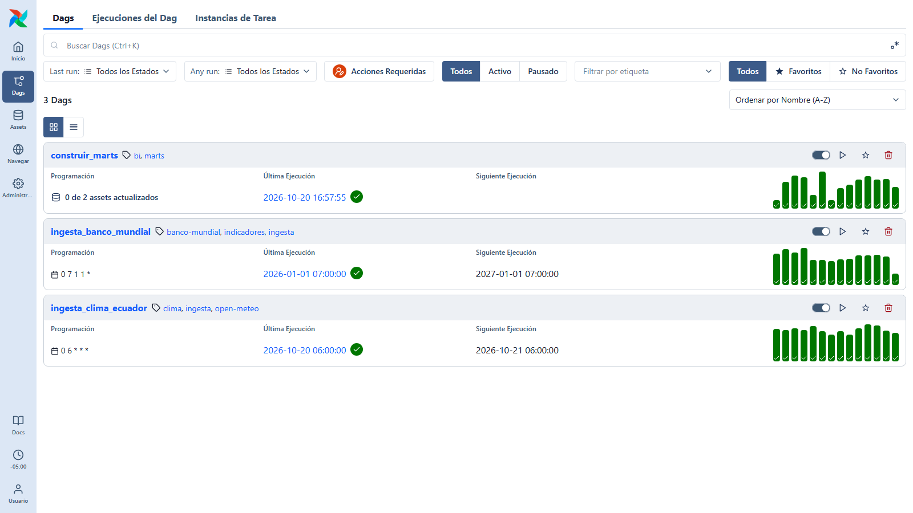
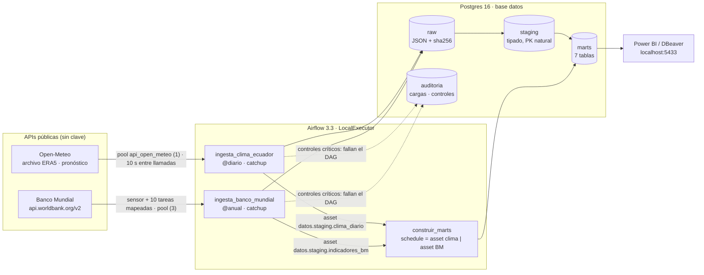
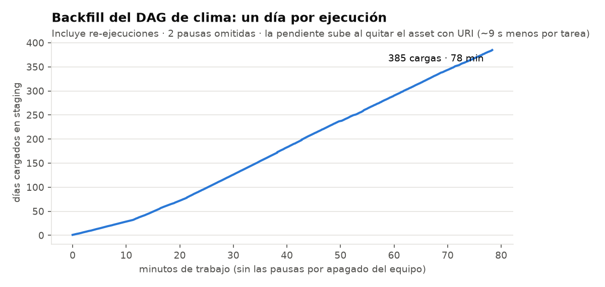
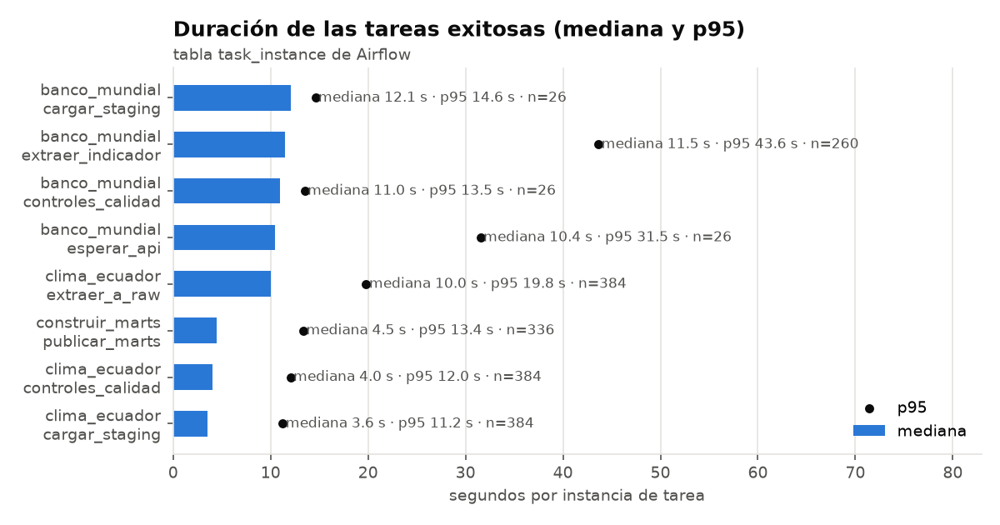
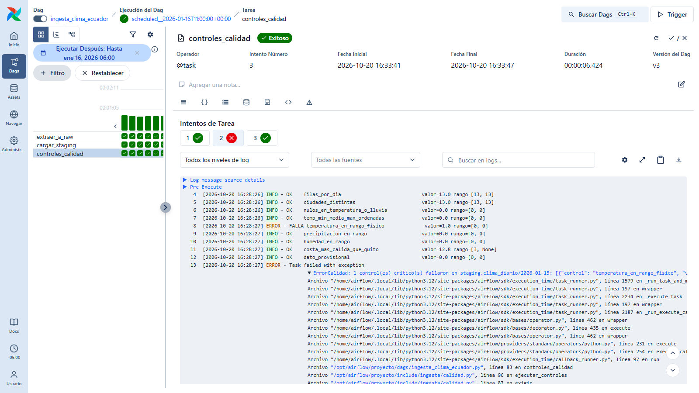
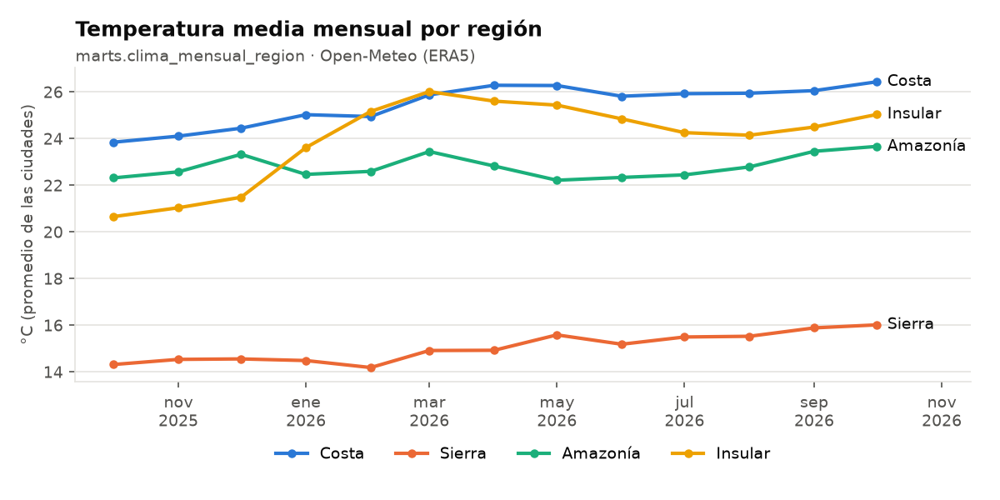
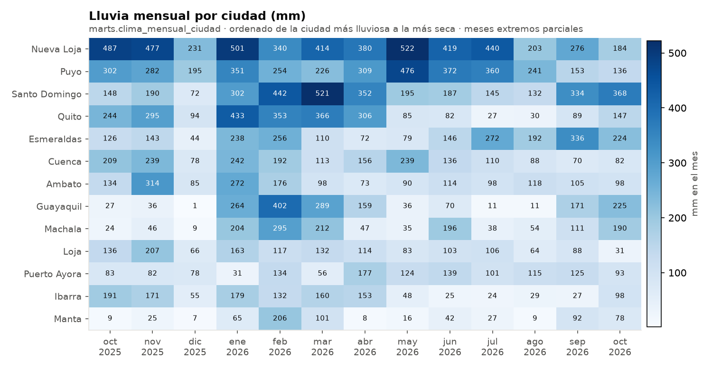
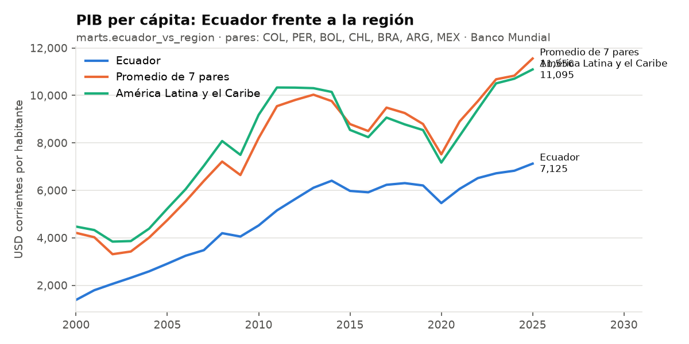

# Ingesta diaria de APIs públicas con Apache Airflow · clima del Ecuador + Banco Mundial

[](https://github.com/GUAR-NIX/portafolio-cloud/actions/workflows/airflow-apis-postgres.yml)

Orquestación con **Apache Airflow 3.3** en Docker Compose: tres DAG que traen el clima diario de **13 ciudades
del Ecuador** (Open-Meteo) y **10 indicadores del Banco Mundial** para Ecuador y 7 países de la región, y los
cargan en Postgres por capas: **raw (JSON tal cual) → staging (tipado) → marts (listos para Power BI)**.
Backfill real de **384 días** (1-oct-2025 → 19-oct-2026) y **26 años** (2000–2025), con controles de calidad que
detienen el DAG cuando los datos están mal.

| | |
|---|---|
| **Orquestador** | Airflow 3.3.2 (imagen oficial), LocalExecutor, memoria limitada por servicio (≈ 5,3 GB en total) |
| **DAG** | `ingesta_clima_ecuador` (diario) · `ingesta_banco_mundial` (anual) · `construir_marts` (por *assets*) |
| **Backfill** | `catchup=True`: 384 ejecuciones diarias + 26 anuales, **todas en verde** |
| **Cargado** | 4.992 filas de clima · 2.234 valores del Banco Mundial · 7 tablas mart |
| **Calidad** | 9 controles por día, 16 por año y 7 de conciliación antes de publicar: **6.405 evaluaciones registradas** |
| **Resiliencia** | Reintentos en 2 niveles, pool + limitador para la cuota de la API, re-ejecución idempotente |
| **Pruebas** | 55 pruebas (integridad de DAG, lógica pura, SQL contra Postgres real) + CI en GitHub Actions |
| **Nube** | Cómo llevarlo a MWAA / Cloud Composer, en la [guía](docs/GUIA_PASO_A_PASO.md#llevarlo-a-la-nube-sin-desplegarlo) (no desplegado) · [costo estimado](#costo-estimado-en-la-nube-sin-desplegar): MWAA ≈ 405 USD/mes frente a ≈ 15–50 USD/mes con Lambda |



## Arquitectura



**Por DAG**

| DAG | Una ejecución = | Tareas | Qué demuestra |
|---|---|---|---|
| `ingesta_clima_ecuador` | un día (`data_interval_start`, hora de Ecuador) | `extraer_a_raw` → `cargar_staging` → `controles_calidad` | backfill por fecha, idempotencia, pool y limitador de cuota, elección archivo/pronóstico |
| `ingesta_banco_mundial` | un año (2000–2025) | `esperar_api` (sensor *reschedule*) → `extraer_indicador` ×10 (**mapeo dinámico**) → `cargar_staging` → `controles_calidad` | sensores, paralelismo controlado, paginación de la API |
| `construir_marts` | cada vez que llega un evento de asset | `publicar_marts` (write-audit-publish en una transacción) | dependencias entre DAG por datos, conciliación antes de publicar |

## Resultados (ejecución real)

### Backfill



| DAG | Ejecuciones | Estado final | Filas cargadas |
|---|---:|---|---:|
| `ingesta_clima_ecuador` | 384 (1-oct-2025 → 19-oct-2026) | 384/384 en verde | 384 respuestas JSON en raw (4,3 MB) · 4.992 filas en staging |
| `ingesta_banco_mundial` | 26 (2000 → 2025) | 26/26 en verde | 260 respuestas (2.340 registros) · 2.234 valores no nulos |
| `construir_marts` | 343 (disparadas por assets) | 343/343 en verde (14 re-ejecutadas tras corregir un bug, ver abajo) | 7 tablas · 5.729 filas |

- **Ritmo:** 5,2 días por minuto en régimen; 78 minutos de trabajo efectivo en total. El techo lo pone
  la cuota gratuita de Open-Meteo, no Airflow (ver *Decisiones*).
- **El equipo se apagó dos veces durante el backfill.** Al volver, las ejecuciones que estaban a medias
  (4 cada vez) superaron su `dagrun_timeout` y quedaron fallidas; un *Clear* las re-ejecutó y, como cada día es idempotente,
  terminaron igual que las demás.
- **Dato provisional:** los últimos 5 días (15–19 oct) vinieron de la API de pronóstico; el control no crítico
  `dato_provisional` los marcó (5 advertencias, 65 filas) y se reemplazan con el archivo ERA5 al re-ejecutarlos.
- **Llamadas a la API:** 384 descargas (una por día, 4.992 llamadas de cuota) a pesar de las re-ejecuciones: re-ejecutar un día que ya tiene el dato definitivo
  no llama a la API (`descargas` sigue en 1).

### Duración de las tareas



| DAG · tarea | Instancias | Mediana | p95 | Con reintento |
|---|---:|---:|---:|---:|
| `construir_marts` · `publicar_marts` | 336 | 4,5 s | 13,4 s | 2 |
| `ingesta_banco_mundial` · `cargar_staging` | 26 | 12,1 s | 14,6 s | 1 |
| `ingesta_banco_mundial` · `controles_calidad` | 26 | 11,0 s | 13,5 s | 1 |
| `ingesta_banco_mundial` · `esperar_api` | 26 | 10,4 s | 31,5 s | 1 |
| `ingesta_banco_mundial` · `extraer_indicador` | 260 | 11,5 s | 43,6 s | 40 |
| `ingesta_clima_ecuador` · `cargar_staging` | 384 | 3,6 s | 11,2 s | 1 |
| `ingesta_clima_ecuador` · `controles_calidad` | 384 | 4,0 s | 12,0 s | 1 |
| `ingesta_clima_ecuador` · `extraer_a_raw` | 384 | 10,0 s | 19,8 s | 17 |

`extraer_a_raw` tarda ~10 s **a propósito** (el limitador de cuota). Los reintentos de `extraer_indicador` y `extraer_a_raw` son del bug de psycopg 3 del arranque y de las pausas por apagado; todos se recuperaron solos.

### Controles de calidad

| Capa | Controles | Evaluaciones | Fallos críticos |
|---|---|---:|---:|
| `staging.clima_diario` (por día) | 13 filas y 13 ciudades, sin nulos, `min ≤ media ≤ max`, rango físico de temperatura, lluvia y humedad, Guayaquil > Quito + 3 °C (detecta ciudades cruzadas), advertencia si el dato es provisional | 3.474 | 1 (la demostración de abajo) |
| `staging.indicadores_bm` (por año) | filas > 0, Ecuador presente, solo países e indicadores pedidos, sin duplicados, **rango por indicador** (10), advertencia de cobertura | 432 | 0 |
| `marts` (antes del `COMMIT`) | conciliación de filas y de lluvia total mart ↔ staging, celdas del pivote = valores de staging, sin duplicados ni huérfanos | 2.499 | 16 (bug de diseño, corregido: ver abajo) |

**Demostración de un control que falla.** Se cambió a mano la máxima de Loja del 15-ene-2026 a 80 °C y se
re-ejecutaron solo los controles de ese día: `temperatura_en_rango_fisico` falló, la tarea quedó en rojo **sin
reintentos** y el *callback* dejó la línea `ALERTA` en el log ([log](reports/logs/control_calidad_fallido_2026-01-15.log)).
Al re-ejecutar el día completo, staging se reconstruyó desde raw (sin volver a llamar a la API) y volvió a verde.



### Tres problemas reales que aparecieron al correrlo

1. **La conciliación de los marts fallaba durante el backfill** (diferencia de −13 filas, un día de 13 ciudades;
   16 fallos en total). Construir en una tarea y validar en otra fallaba: entre ambas, otras
   ejecuciones seguían escribiendo en staging. **Corrección:** *write-audit-publish* en una sola transacción
   `REPEATABLE READ` (`bd.construir_marts(conn, validar=...)`): construir y validar ven la misma foto, y si un
   control falla se hace `ROLLBACK` y el tablero sigue viendo los datos ya publicados. Hay una prueba para eso
   ([log del fallo](reports/logs/construir_marts_conciliacion_fallida.log)).
2. **Cada tarea tardaba ~11 s, y casi todo era arranque.** El log mostraba 9 s entre *Filling up the DagBag* y
   *Worker startup parse complete*. Con `python -X importtime` se vio que crear `Asset("postgres://...")` hace que
   Airflow inicialice los normalizadores de URI de **todos** los proveedores, lo que importa los hooks de S3 y GCS.
   **Corrección:** assets por nombre (`Asset(name="datos.staging.clima_diario")`): las tareas bajaron a 3–4 s y el
   backfill pasó de 2,8 a 5,2 días por minuto.
3. **`PostgresHook.get_conn()` devolvía psycopg 3** con el proveedor de Postgres de Airflow y `execute_values` (psycopg2)
   fallaba. Las primeras tareas se recuperaron solas con los reintentos tras la corrección: la conexión se arma
   con psycopg2 a partir de la conexión de Airflow (`airflow_comun.conexion`).

### Lo que dicen los datos (marts)




| Ciudad | Región | Temp. media | Amplitud diaria | Lluvia (anualizada) | Días con lluvia | Días ≥ 30 °C | Máxima (fecha) | Día más lluvioso |
|---|---|---:|---:|---:|---:|---:|---|---|
| Guayaquil | Costa | 26,7 °C | 8,0 °C | 1.618 mm | 42 % | 322 | 35,5 °C (2025-12-26) | 59,3 mm (2026-03-21) |
| Manta | Costa | 26,0 °C | 6,0 °C | 652 mm | 35 % | 178 | 33,5 °C (2026-04-10) | 25,4 mm (2026-02-23) |
| Esmeraldas | Costa | 25,7 °C | 6,2 °C | 2.128 mm | 75 % | 121 | 31,7 °C (2025-12-11) | 42,9 mm (2026-09-27) |
| Machala | Costa | 25,4 °C | 4,9 °C | 1.387 mm | 52 % | 48 | 32,4 °C (2026-04-11) | 121,8 mm (2026-06-09) |
| Nueva Loja | Amazonía | 24,7 °C | 7,3 °C | 4.634 mm | 88 % | 141 | 33,7 °C (2026-03-22) | 134,9 mm (2025-10-24) |
| Puerto Ayora | Insular | 23,9 °C | 4,3 °C | 1.272 mm | 73 % | 11 | 30,8 °C (2026-04-11) | 50,1 mm (2026-04-15) |
| Santo Domingo | Costa | 23,4 °C | 6,5 °C | 3.221 mm | 90 % | 13 | 31,1 °C (2026-10-03) | 120,1 mm (2026-10-19) |
| Puyo | Amazonía | 20,9 °C | 9,2 °C | 3.475 mm | 94 % | 5 | 30,3 °C (2026-09-21) | 67,8 mm (2026-05-21) |
| Ibarra | Sierra | 17,7 °C | 10,4 °C | 1.227 mm | 53 % | 0 | 29,7 °C (2026-10-04) | 35,7 mm (2025-10-10) |
| Loja | Sierra | 16,2 °C | 8,5 °C | 1.341 mm | 69 % | 0 | 26,3 °C (2026-06-10) | 35,7 mm (2025-11-15) |
| Ambato | Sierra | 14,1 °C | 9,5 °C | 1.689 mm | 77 % | 0 | 24,8 °C (2026-04-01) | 34,1 mm (2025-11-03) |
| Cuenca | Sierra | 14,0 °C | 11,1 °C | 1.856 mm | 80 % | 0 | 23,7 °C (2026-04-02) | 36,0 mm (2026-05-06) |
| Quito | Sierra | 13,2 °C | 9,6 °C | 2.424 mm | 67 % | 0 | 23,5 °C (2026-09-01) | 69,0 mm (2026-04-16) |

`marts.resumen_ciudad`, 384 días por ciudad (1-oct-2025 → 2026-10-19). La amplitud térmica diaria de la Sierra (8,5–11 °C) es mayor que la de la Costa (4,9–8 °C) y la de Galápagos (4,3 °C); Nueva Loja y Puyo (Amazonía) superan los 3.400 mm al año, y Manta es la ciudad más seca. Guayaquil pasa de casi 0 mm en diciembre a 402 mm en febrero: la estación lluviosa de la Costa se ve sin ningún filtro.



| Indicador | Año | Ecuador | Promedio 7 pares | América Latina | Puesto de Ecuador |
|---|---:|---:|---:|---:|---:|
| Acceso a electricidad | 2024 | 98,5 % | 98,4 % | 98,0 % | 5 de 8 |
| CO2 (t por habitante) | 2024 | 2,64 | 2,86 | 2,68 | 4 de 8 |
| Inflación | 2025 | 0,7 % | 6,5 % | 2,1 % | 7 de 7 |
| Agro / PIB | 2025 | 9,7 % | 5,8 % | 6,8 % | 2 de 6 |
| Crecimiento del PIB | 2025 | 3,7 % | 2,0 % | 2,3 % | 2 de 8 |
| PIB per cápita (USD) | 2025 | 7.125 | 11.556 | 11.095 | 7 de 8 |
| Desempleo | 2025 | 3,3 % | 5,9 % | 5,5 % | 6 de 8 |
| Población | 2025 | 18.289.896 | 73.007.821 | 666.592.570 | 7 de 8 |
| Población urbana | 2025 | 63,4 % | 83,7 % | 81,5 % | 8 de 8 |

Último año con dato por indicador (`marts.ecuador_vs_region`; puesto 1 = valor más alto). Gini queda fuera: en el último año solo Ecuador lo publicó, y el mart lo muestra así en lugar de inventar un promedio.

**Tablas mart** (`localhost:5433`, base `datos`):

| Tabla | Filas | Grano / uso |
|---|---:|---|
| `marts.fct_clima_diario` | 4.992 | hechos: fecha × ciudad, con banderas (lluvioso, lluvia fuerte, caluroso) y balance hídrico |
| `marts.dim_ciudad` | 13 | provincia, región, coordenadas y piso altitudinal |
| `marts.clima_mensual_ciudad` | 169 | mes × ciudad: temperatura, extremos, lluvia, días lluviosos, días provisionales |
| `marts.clima_mensual_region` | 52 | mes × región (cada ciudad pesa igual) |
| `marts.resumen_ciudad` | 13 | ficha de cada ciudad con sus extremos y fechas |
| `marts.indicadores_pais_anual` | 234 | país × año en formato ancho (10 columnas de indicadores) |
| `marts.ecuador_vs_region` | 256 | indicador × año: Ecuador, promedio de pares, América Latina, puesto, cambio anual |

## Decisiones técnicas

| Decisión | Por qué |
|---|---|
| **Un día por ejecución** con `CronDataIntervalTimetable("0 6 * * *", America/Guayaquil)` | En Airflow 3 el horario por defecto no tiene intervalo; explícito, "un run = un día" queda claro y cada tarea usa `data_interval_start`, nunca "hoy" |
| raw guarda el **JSON completo** (+ URL, parámetros, SHA-256, nº de descargas) | Staging se reconstruye sin volver a llamar a la API; auditoría de qué llegó y cuándo |
| Staging = `DELETE` + `INSERT` de la partición en una transacción | Idempotente: re-ejecutar una fecha deja exactamente lo mismo (probado) |
| Archivo ERA5 para días > 5 días, API de pronóstico para los recientes | El archivo se publica con retraso; el dato reciente queda marcado `pronostico` y se reemplaza al re-ejecutar |
| **Pool de 1 cupo + 10 s entre llamadas** (medido contra la última descarga en raw) | La cuota gratuita de Open-Meteo es 5.000 llamadas/hora y **cada ciudad cuenta como una**: 13 × 6/min × 60 = 4.680/h. 9 variables y no 10 por la misma razón |
| No volver a pedir días con dato definitivo | Un *Clear* masivo no consume cuota (parámetro `forzar_descarga` para forzarlo) |
| Reintentos en 2 niveles | Cliente HTTP: 429 (respeta `Retry-After`), 5xx y timeouts con espera exponencial; un 400 falla de inmediato. Airflow: 3 reintentos exponenciales (30 s → 10 min). Controles de calidad: **0 reintentos** |
| Sensor `esperar_api` en modo *reschedule* | No ocupa un cupo mientras espera (sin *triggerer*, que no hace falta aquí) |
| **Mapeo dinámico** por indicador | Si falla un indicador se reintenta solo ese; cada uno tiene su log |
| **Assets** en lugar de `ExternalTaskSensor` | Sin horarios acoplados ni cupos esperando; los eventos seguidos se agrupan (≈ 343 reconstrucciones para 410 ejecuciones de ingesta) |
| Controles en **SQL propio** (no Great Expectations ni Soda) | ~30 reglas sobre tablas pequeñas en la misma base. GX añade cientos de MB que chocan con las restricciones de Airflow; Soda pide otra configuración. Cada regla es una línea de SQL con rango, probada con pytest y registrada en `auditoria.controles_calidad` para un tablero de calidad; se traduce 1:1 a Soda si el equipo crece |
| Lógica en `include/ingesta` **sin importar Airflow** | Se prueba en cualquier Python; los DAG solo orquestan y no hacen red ni consultas al parsearse |
| LocalExecutor, sin Celery/Redis/triggerer | Una sola máquina: menos memoria (≈ 5,3 GB tope) y menos piezas |
| `SimpleAuthManager` sin login | **Solo local.** En la nube lo reemplaza IAM |

## Estructura

```
dags/                      3 DAG (solo orquestación)
include/ingesta/           paquete sin Airflow (salvo airflow_comun.py)
  config.py                  ciudades, variables, indicadores y rangos
  apis.py                    clientes HTTP con reintentos, elección archivo/pronóstico, paginación
  transformar.py             JSON -> filas (verifica orden de ciudades, día y variables)
  calidad.py                 Control(nombre, sql, mín, máx, crítico) + registro + exigir
  bd.py                      raw/staging idempotentes, write-audit-publish de marts, auditoría
  airflow_comun.py           assets, argumentos por defecto, callback de alerta, conexión
sql/00_esquemas.sql        raw · staging · marts · auditoria
sql/marts/                 7 tablas (dim_ciudad, fct_clima_diario, clima_mensual_ciudad/region, resumen_ciudad,
                           indicadores_pais_anual, ecuador_vs_region)
tests/                     55 pruebas + fixtures con respuestas reales de las dos APIs
scripts/                   descargar_datos.py · exportar_resultados.py · capturas_ui.ps1
docker-compose.yml         postgres · airflow-init · apiserver · scheduler · dag-processor · pruebas
reports/                   resultados.json · figures/ · capturas/ · logs/ (muestras legibles)
docs/GUIA_PASO_A_PASO.md   cómo correrlo, demostración de fallos, nube y preguntas de entrevista
```

## Cómo reproducirlo

Paso a paso en [docs/GUIA_PASO_A_PASO.md](docs/GUIA_PASO_A_PASO.md).

```powershell
Copy-Item .env.example .env
docker compose up -d --build                     # http://localhost:8080
docker compose run --rm pruebas                  # 55 pruebas
docker compose exec airflow-scheduler airflow dags unpause construir_marts
docker compose exec airflow-scheduler airflow dags unpause ingesta_banco_mundial
docker compose exec airflow-scheduler airflow dags unpause ingesta_clima_ecuador     # backfill ≈ 1,3 h
python -m venv .venv; .\.venv\Scripts\pip install -r requirements.txt
.\.venv\Scripts\python scripts\exportar_resultados.py
docker compose down
```


## Costo estimado en la nube (sin desplegar)

Estimación de orden de magnitud para llevar este proyecto a la nube; el detalle de equivalencias está en la
[guía](docs/GUIA_PASO_A_PASO.md#llevarlo-a-la-nube-sin-desplegarlo). **No se desplegó nada**: son cálculos con
tarifas de lista de `us-east-1` (sin capa gratuita) que conviene confirmar en la
[calculadora de AWS](https://calculator.aws/) antes de decidir.

**Supuestos:** régimen estable de una ejecución de clima al día, una de Banco Mundial al año y ~1 reconstrucción
de marts al día (≈ 5 MB de datos al año, una base Postgres de < 1 GB); entorno MWAA `mw1.small` (hasta 50 DAG),
encendido 24/7 (730 h/mes); RDS `db.t4g.micro` con 20 GB; un NAT Gateway, porque las APIs públicas están en Internet.

**Tarifas usadas (aprox.):** MWAA `mw1.small` 0,49 USD/hora · RDS `db.t4g.micro` ≈ 0,016 USD/hora + 20 GB a
0,115 USD/GB-mes · NAT Gateway 0,045 USD/hora + 0,045 USD/GB · S3, CloudWatch Logs y Secrets Manager: pocos USD.

| Opción | Orquestación | Base de datos | Red y otros | Total aprox. |
|---|---:|---:|---:|---:|
| **A. MWAA `mw1.small` 24/7** (lo que reemplaza al `docker compose`) | ≈ 358 USD/mes (730 h × 0,49) | ≈ 14 USD/mes (RDS + disco) | ≈ 33 USD de NAT + ≈ 2 USD de S3, logs y secretos | **≈ 405 USD/mes** |
| **B. EventBridge Scheduler + Lambda** (una función por DAG, misma lógica de `include/ingesta`) | < 1 USD/mes (≈ 35 invocaciones al mes de < 1 min) | ≈ 14 USD/mes (RDS) | 0–33 USD de NAT (solo si la función va dentro de la VPC de la base) + ≈ 1 USD | **≈ 15–50 USD/mes** |
| **C. GCP: Cloud Scheduler + Cloud Run jobs + Cloud SQL `db-f1-micro`** | ≈ 0 USD (capa gratuita) | ≈ 10–15 USD/mes | ≈ 1 USD | **≈ 10–15 USD/mes** |

Lecturas para decidir:

- **El volumen no justifica Airflow gestionado:** MWAA cobra por tener el entorno encendido (≈ 358 USD/mes), no por
  los 5 MB al año que procesa; Cloud Composer 3 *small* queda en un orden similar. Con esta carga el 90 % del costo
  de A es el entorno.
- **Qué se pierde en B y C:** la interfaz de backfills, los reintentos por tarea, los *assets* y el historial de
  ejecuciones. Si el equipo necesita eso, A se justifica; si solo hay que correr tres tareas al día, no.
- **El backfill inicial** (384 días de clima + 26 años del Banco Mundial, ≈ 1,3 h) cuesta lo mismo que cualquier otro
  rato de la opción elegida: en A son ≈ 0,6 USD de MWAA durante esa hora y media.
- **No incluye** trabajadores adicionales de MWAA (≈ 0,055 USD/hora cada uno si el entorno escala), Multi-AZ de RDS,
  transferencia hacia Internet ni Power BI.

## Fuentes de datos y licencia

| Fuente | Qué se usa | Licencia |
|---|---|---|
| [Open-Meteo Historical Weather API](https://open-meteo.com/en/docs/historical-weather-api) (reanálisis ERA5 de Copernicus/ECMWF) y [Forecast API](https://open-meteo.com/en/docs) | 9 variables diarias, 13 ciudades | [CC BY 4.0](https://open-meteo.com/en/license), uso no comercial gratuito (≤ 10.000 llamadas/día) |
| [World Bank Indicators API v2](https://datahelpdesk.worldbank.org/knowledgebase/articles/889392) | 10 indicadores WDI, 9 países/agregados, 2000–2025 | [CC BY 4.0](https://www.worldbank.org/en/about/legal/terms-of-use-for-datasets) |

`scripts/descargar_datos.py` baja los mismos datos a `data/raw/` sin Airflow (un mes por petición para ahorrar
cuota).

## Parte de un portafolio

Proyecto 23 de 30. Los proyectos originales (SQL, Python, ML, IA y Cloud) usan las importaciones de la
SENAE; este cambia de fuente para mostrar ingesta desde APIs con un orquestador.

**Licencia.** El **código** de este repositorio es MIT ([LICENSE](LICENSE)). Los **datos** no lo son: siguen la
licencia de su fuente, la que se cita en la tabla de arriba (CC BY 4.0 en ambos casos).
