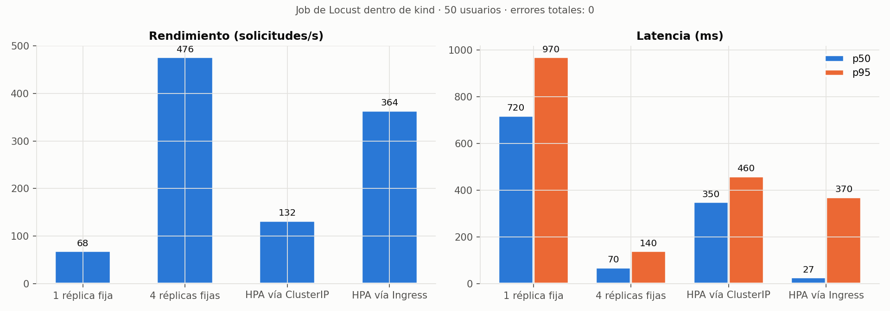
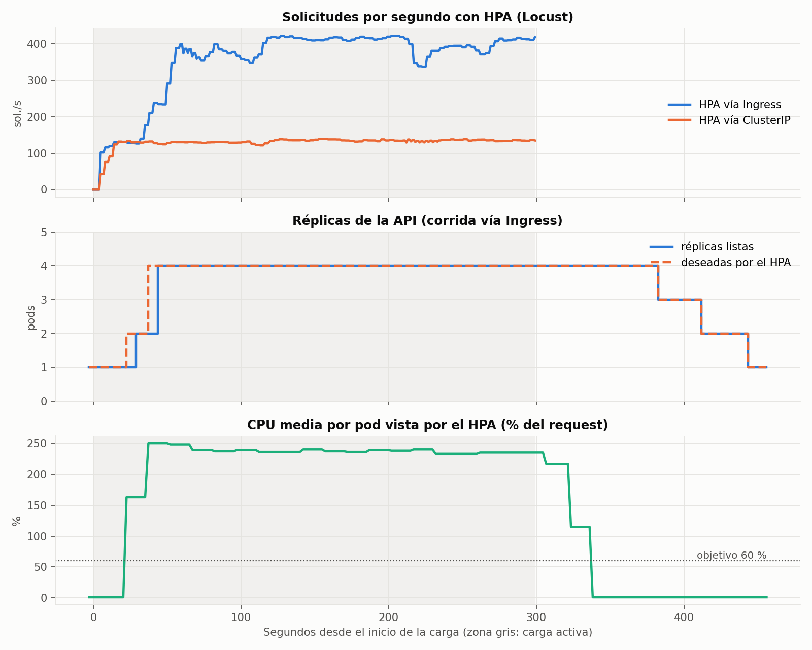
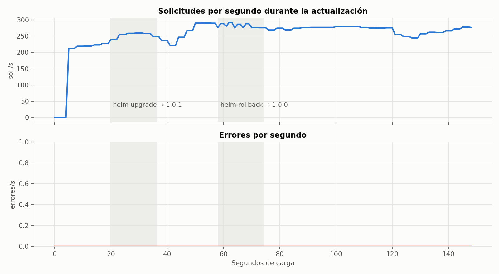
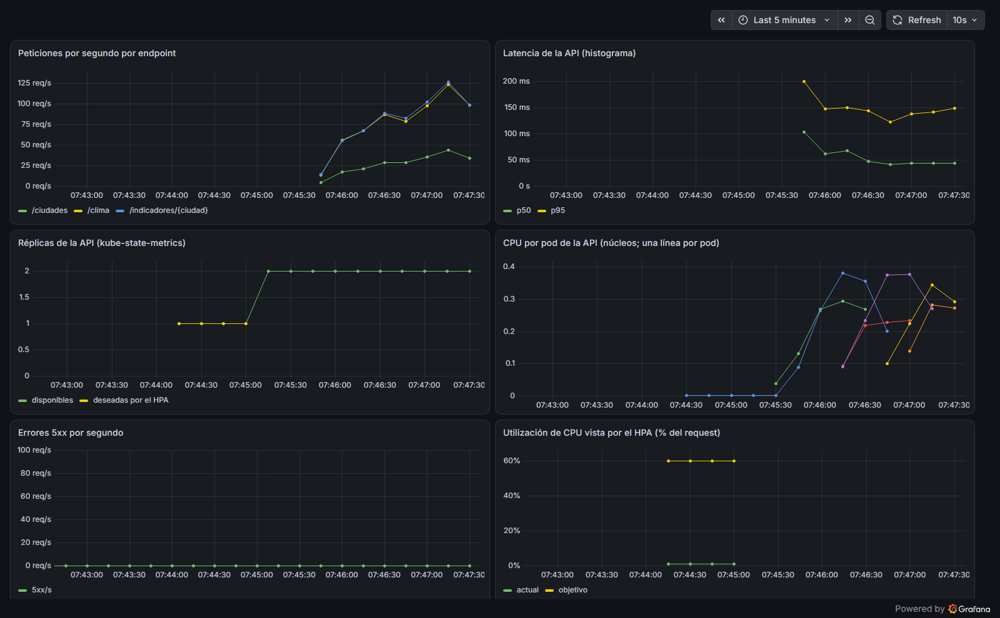
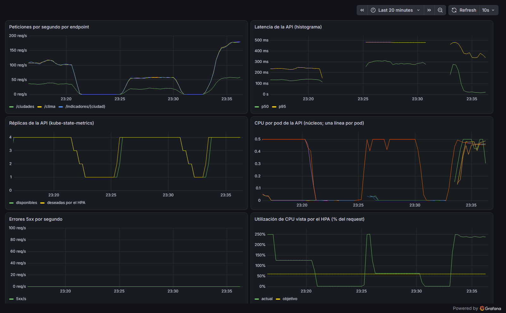
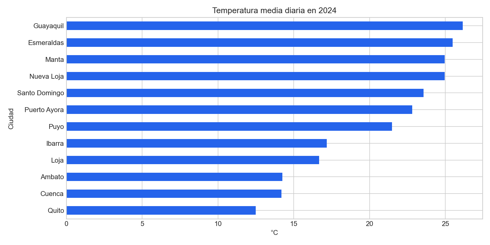
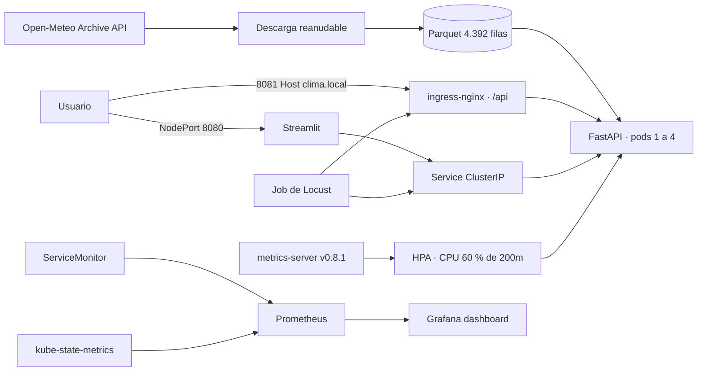

# ☁️ API de clima del Ecuador en Kubernetes · FastAPI, Helm y observabilidad

   

API FastAPI y aplicación Streamlit para consultar **4.392 observaciones diarias** de clima de **12 ciudades del
Ecuador** durante 2024, desplegadas en un clúster **kind** local con Helm, Ingress, HPA, metrics-server,
Prometheus y Grafana. Todo lo que sigue se ejecutó de verdad en Docker Desktop (Windows, 16 GB para el motor):
las cifras salen de `reports/` y no se crea infraestructura en la nube.

## Resultados medidos

### Escalado horizontal: 1 réplica frente a 4 y HPA

Un **Job de Locust dentro del clúster** (no `kubectl port-forward`) con 50 usuarios concurrentes y la mezcla 3/7
`/indicadores/{ciudad}`, 3/7 `/clima` (ciudad y fecha aleatorias) y 1/7 `/ciudades`. Cada pod de la API tiene
`request` de 200m y `limit` de 500m de CPU.

| Escenario | Duración | Solicitudes | Errores | Solicitudes/s | p50 | p95 | p99 |
|---|---:|---:|---:|---:|---:|---:|---:|
| 1 réplica fija | 120 s | 8.237 | 0 | 68,5 | 720 ms | 970 ms | 1.100 ms |
| 4 réplicas fijas | 120 s | 57.172 | 0 | 476,3 | 70 ms | 140 ms | 160 ms |
| HPA 1→4, tráfico al Service (ClusterIP) | 300 s | 39.658 | 0 | 132,2 | 350 ms | 460 ms | 500 ms |
| HPA 1→4, tráfico por ingress-nginx | 300 s | 109.115 | 0 | 363,7 | 27 ms | 370 ms | 460 ms |

Fuente: [`reports/carga_cluster_resumen.csv`](reports/carga_cluster_resumen.csv) y
[`reports/carga_cluster.json`](reports/carga_cluster.json) (incluye el detalle por endpoint).



**Lectura:**

- Con 4 réplicas fijas el rendimiento es 7 veces el de una sola. Ese pod único pasa el 100 % de los periodos
  CFS con throttling en su limit de 500m, y las colas disparan la latencia.
- **Hallazgo:** con el HPA y tráfico directo al Service, el clúster llegó a 4 réplicas, pero el rendimiento casi
  no cambió. kube-proxy reparte por **conexión**, y los usuarios de Locust (keep-alive) abrieron todas sus
  conexiones cuando solo existía un pod. En Grafana se ve un pod en 0,5 núcleos y tres casi en cero. El HPA veía
  ~63 % de media, por encima del objetivo, y mantenía 4 réplicas que no ayudaban.
- Por **ingress-nginx**, que reparte cada petición entre los Endpoints, los cuatro pods trabajaron (465–500m
  cada uno con `kubectl top`) y el rendimiento en régimen subió a ~400 solicitudes/s.

**Tiempo de escalado** (muestreo de HPA y Deployment cada 2 s;
[`reports/carga_cluster_hpa-ingress_muestras.csv`](reports/carga_cluster_hpa-ingress_muestras.csv)):

| Corrida | Primera decisión de escalar | 4 réplicas listas | Bajadas durante la carga | De fin de carga a 1 réplica |
|---|---:|---:|---:|---:|
| HPA vía ClusterIP | 23,3 s | 44,4 s | 0 | 129,1 s |
| HPA vía Ingress | 22,5 s | 43,6 s | 0 | 144,2 s |



**Latencia en régimen** (del segundo 60 al final, con el escalado ya terminado), medida con el histograma de
Prometheus. Los percentiles del historial de Locust son acumulados desde el inicio, así que en las corridas con
HPA arrastran el primer minuto con un pod saturado.

| Escenario | Solicitudes/s | p50 | p95 | p99 |
|---|---:|---:|---:|---:|
| 1 réplica fija | 76,0 | 449 ms | 940 ms | 992 ms |
| 4 réplicas fijas | 522,2 | 44 ms | 108 ms | 142 ms |
| HPA vía ClusterIP | 134,5 | 289 ms | 479 ms | 496 ms |
| HPA vía Ingress | 399,5 | 18 ms | 372 ms | 478 ms |

Fuente: [`reports/carga_cluster_regimen.csv`](reports/carga_cluster_regimen.csv). Por Ingress la mediana baja a
18 ms, pero la cola sigue en ~370 ms. Las solicitudes se repartieron casi exactas (~23.800 por pod), pero el
throttling no: un pod pasó el 99 % de sus periodos CFS limitado (p95 de 470 ms) frente al 48–78 % de los demás.
Con los cuatro pods en su limit, cualquier desequilibrio de CPU se ve en la cola. Más réplicas o un limit mayor lo
atenúan; aquí el máximo de 4 réplicas es deliberado para no agotar la laptop.

### Actualización sin caída y rollback

Mientras corría un Job de Locust (30 usuarios, 150 s, tráfico **directo al Service**, el caso más exigente porque
no hay reintentos del Ingress), se hizo `helm upgrade` de la imagen 1.0.0 a 1.0.1 con 2 réplicas,
`maxSurge: 1` y `maxUnavailable: 0`. Después, `helm rollback` a la revisión anterior. La versión servida se
verificó con `/salud` antes, entre y después de los dos pasos.

| Corrida | Solicitudes | Errores | Solicitudes/s | p95 | Upgrade | Rollback |
|---|---:|---:|---:|---:|---:|---:|
| Sin drenaje: preStop solo con `sleep 5` | 37.165 | **14** (`ConnectionResetError`) | 247,7 | 170 ms | 14,9 s | 14,5 s |
| Con drenaje en el preStop | 39.842 | **0** | 265,5 | 180 ms | 16,8 s | 16,4 s |

Fuentes: [`reports/rolling_update.json`](reports/rolling_update.json),
[`reports/rolling_helm_history.json`](reports/rolling_helm_history.json) (revisión 5: «Rollback to 3») y, para la
corrida sin drenaje, [`reports/rolling_update_sin_drenaje.json`](reports/rolling_update_sin_drenaje.json) con sus
`rolling_sin_drenaje_*.csv`.

**Por qué fallaba sin drenaje.** `maxUnavailable: 0` y la readiness garantizan que siempre haya pods listos, pero
retirar un pod de los Endpoints solo afecta a las conexiones **nuevas**. Las conexiones keep-alive ya abiertas
siguieron llegando al pod viejo. Al recibir SIGTERM, Uvicorn las cerró, y los clientes que justo enviaban
recibieron `Connection reset by peer`: 10 errores en el upgrade y 4 en el rollback.

**La corrección.** El `preStop` llama a `POST /drenar` (solo se acepta desde 127.0.0.1) y espera 10 s. Desde ese
momento cada respuesta lleva `Connection: close` y `/listo` devuelve 503, así que los clientes abren conexiones
nuevas hacia los pods vivos antes del SIGTERM. Uvicorn arranca con `--timeout-graceful-shutdown 10` y
`terminationGracePeriodSeconds` es 30, más que el drenaje y el cierre juntos. Un cliente que no envíe nada durante
esos 10 s todavía podría ver un cierre: el arreglo reduce la ventana, no la elimina en teoría.





En Grafana se ven aparecer los pods nuevos en el panel de CPU (cada línea es un pod) mientras las réplicas
disponibles se mantienen en 2 y los errores 5xx en 0.

### Observabilidad: Prometheus y Grafana

- Prometheus raspa `/metricas` mediante el `ServiceMonitor` del chart. kube-state-metrics aporta las réplicas y el
  estado del HPA.
- El dashboard versionado [`monitoreo/dashboard-clima.json`](monitoreo/dashboard-clima.json) lo carga el sidecar
  de Grafana. Muestra solicitudes/s por endpoint, p50/p95, réplicas disponibles y deseadas, CPU por pod, errores
  5xx y la utilización que ve el HPA frente al objetivo.
- **Cubetas del histograma:** las de `prometheus-fastapi-instrumentator` por defecto son 0,1 / 0,5 / 1 s, y con
  respuestas de pocos milisegundos el p95 de Prometheus no significaba nada. Se usan cubetas de 5 ms a 2,5 s. Con
  ellas, el p95 de Prometheus queda a 19 ms o menos del que mide Locust en los cuatro escenarios
  ([`reports/p95_prometheus_vs_locust.csv`](reports/p95_prometheus_vs_locust.csv)).

| Escenario | p95 Locust (cliente) | p95 Prometheus (servidor) |
|---|---:|---:|
| 1 réplica fija | 970 ms | 961 ms |
| 4 réplicas fijas | 140 ms | 123 ms |
| HPA vía ClusterIP | 460 ms | 479 ms |
| HPA vía Ingress | 370 ms | 384 ms |

La captura muestra las corridas del HPA. Hasta las 23:30 el tráfico va al Service: 4 réplicas, pero un solo pod
con CPU. Después va por Ingress, con los cuatro pods en ~0,5 núcleos.



### Datos

| Métrica | Resultado |
|---|---:|
| Filas | 4.392 |
| Ciudades | 12 |
| Periodo | 1-ene-2024 → 31-dic-2024 (366 días por ciudad) |
| Nulos / duplicados ciudad-fecha | 0 / 0 |
| Ciudad más cálida en promedio | Guayaquil · 26,15 °C |
| Mayor precipitación acumulada | Nueva Loja · 3.266,8 mm |

Estas cifras provienen de [`reports/resultados_datos.json`](reports/resultados_datos.json) y del Parquet generado
desde Open-Meteo.



La línea base local sin contenedor (Uvicorn, 50 usuarios, 30 s: 410,64 solicitudes/s, p95 de 110 ms) se
conserva en [`reports/carga_local.json`](reports/carga_local.json). No es comparable con kind: no tenía limit de
CPU y usaba otra mezcla de endpoints, sin `/clima`.

## Arquitectura



## API y operación

- `GET /salud`: liveness sin dependencias; devuelve también la versión desplegada.
- `GET /listo`: readiness; exige que el Parquet sea legible y responde 503 mientras el pod drena.
- `GET /ciudades`: catálogo ordenado.
- `GET /clima?ciudad=Quito&fecha=2024-01-01`: observación diaria (422 con parámetros inválidos, 404 si no hay dato).
- `GET /indicadores/{ciudad}`: resumen anual.
- `GET /metricas`: contadores e histogramas Prometheus.
- `POST /drenar`: solo desde 127.0.0.1; lo invoca el preStop.

Imágenes multietapa con Python 3.12 slim, usuario sin privilegios, sin capacidades y API con filesystem de solo
lectura.

## Decisiones y limitaciones

| Decisión | Motivo y límite |
|---|---|
| HPA al 60 % de un request de 200m | Medido: ~4,2 ms de CPU por solicitud, así que 200m ≈ 47 solicitudes/s por pod. En reposo un pod usa 3m (1–2 %): las sondas y el raspado no disparan escalados. Un objetivo del 50 % sobre un request de 50m (25m) se cruzaba con cualquier ráfaga. |
| `behavior` del HPA | Sube hasta el doble cada 15 s y baja como máximo un pod cada 30 s tras 60 s de estabilización. Medido: 0 bajadas durante la carga y vuelta a 1 réplica en 129–144 s. |
| Sin `replicas` en el Deployment cuando hay HPA | Si no, cada `helm upgrade` lo devolvería a 1 réplica en plena carga. |
| Drenaje en el preStop | Sin él, el rolling update dio 14 errores de conexión; con él, 0 en 39.842 solicitudes. |
| Sondas con timeout de 2–3 s | Con el CPU en throttling, el timeout de 1 s por defecto reiniciaba pods sanos. |
| Parquet dentro de la imagen | Demostración autocontenida; para datos cambiantes se usaría almacenamiento externo. |
| Un worker Uvicorn por pod | Kubernetes escala unidades simples y observables; el rendimiento depende del CPU solicitado. |
| HPA por CPU | Disponible con metrics-server; la latencia o la cola serían mejores señales para tráfico irregular. |
| Versiones fijadas | metrics-server v0.8.1, ingress-nginx v1.15.1, kube-prometheus-stack 92.13.1, kind v0.30.0 (Kubernetes v1.34.0), Locust 2.41.5. Nada de `releases/latest`. |
| Monitoreo reducido | Sin Alertmanager, node-exporter ni reglas por defecto ([`monitoreo/valores-kube-prometheus.yaml`](monitoreo/valores-kube-prometheus.yaml)); clúster completo ≈ 2,5 GB. |
| Medición en una laptop | kind comparte CPU con Windows y con otros procesos: son cifras de este entorno, de una corrida por escenario, no capacidad de producción. |

## Verificación realizada

| Comprobación | Estado |
|---|---|
| Descarga real y Parquet | OK · 4.392 filas, SHA-256 en `data/procesados/manifiesto.json` |
| Pytest | OK · 21 pruebas (API, `/clima`, drenaje, histograma y app Streamlit con `AppTest`) |
| Ruff | OK |
| `helm lint --strict` | OK · sin advertencias (el chart tiene icono) |
| Imágenes, kind, Ingress, metrics-server y chart | OK · `scripts/desplegar_kind.ps1`, todos los pods Ready |
| kube-prometheus-stack y dashboard | OK · targets `up`, dashboard cargado por el sidecar |
| Carga dentro del clúster y HPA | OK · 4 escenarios, 214.182 solicitudes y 0 errores |
| Rolling update y `helm rollback` | OK · 0 errores en 39.842 solicitudes (sin drenaje: 14 en 37.165) |
| CI de GitHub Actions | Actualizado, pero no ejecutado localmente: `act` no está instalado. Corre en GitHub. |

El CI construye las imágenes, crea un kind, instala metrics-server con la misma versión fijada, instala el chart
**con el HPA activo**, consulta `/clima` desde dentro del clúster y espera a que el HPA reciba métricas de CPU.

## Reproducir

```powershell
py -3.12 -m venv .venv
.\.venv\Scripts\Activate.ps1
pip install -r requirements-dev.txt
python descargar_datos.py
pytest -q
python scripts\generar_reporte.py
.\scripts\descargar_herramientas.ps1
.\tools\helm.exe lint --strict charts\clima-ecuador
```

Con Docker Desktop operativo:

```powershell
.\scripts\desplegar_kind.ps1       # imágenes, kind, metrics-server, ingress-nginx y chart
.\scripts\instalar_monitoreo.ps1   # Prometheus, Grafana, ServiceMonitor y dashboard
.\scripts\prueba_carga.ps1         # 1 fija, 4 fijas, HPA vía ClusterIP y vía Ingress (~25 min)
.\scripts\demostrar_rolling.ps1    # helm upgrade 1.0.0→1.0.1 y helm rollback bajo carga
.\scripts\eliminar_cluster.ps1
```

## Camino a EKS, GKE o AKS (costo estimado más abajo)

Las imágenes irían a ECR, Artifact Registry o ACR, y se sumarían identidad de carga, secretos administrados, TLS,
un Ingress o balanceador gestionado (que también resuelve el reparto por petición), datos externos, autoscaling de
nodos y alertas. Los manifests no contienen credenciales y este proyecto nunca ejecuta ese despliegue.

## Costo estimado en la nube (sin desplegar)

Orden de magnitud para correr este mismo diseño en un clúster gestionado. **No se desplegó nada**: son cálculos con
tarifas de lista (`us-east-1`, `us-central1` y Este de EE. UU., sin descuentos ni capa gratuita salvo donde se
indica) que conviene confirmar en las calculadoras de [AWS](https://calculator.aws/),
[Google Cloud](https://cloud.google.com/products/calculator) y [Azure](https://azure.microsoft.com/pricing/calculator/).

**Supuestos** (salen de este proyecto): la API pide 200m de CPU y 160 MiB por pod y escala de 1 a 4 réplicas (promedio
de 2); Streamlit pide 25m y 128 MiB; ingress-nginx y metrics-server ≈ 0,2 vCPU en total; el monitoreo
(Prometheus + Grafana + operador + kube-state-metrics) ≈ 0,6 vCPU y 2,5 GiB, el mismo orden de memoria que se midió
en kind. En total ≈ 1,2 vCPU y 3,2 GiB solicitados en promedio, con picos de ≈ 1,6 vCPU. Un balanceador, una
región, 730 h/mes, tráfico de salida despreciable y una base de 20 GB de disco para Prometheus.

**Tarifas usadas (aprox.):** EKS plano de control 0,10 USD/h · `t3.medium` 0,0416 USD/h · ALB 0,0225 USD/h + ≈ 5 USD
de LCU · NAT Gateway 0,045 USD/h · EBS gp3 0,08 USD/GB-mes · GKE Autopilot 0,0445 USD/vCPU-h y 0,0049 USD/GiB-h
(la tarifa de gestión de 0,10 USD/h se compensa con el crédito mensual de ≈ 74 USD de un clúster por cuenta de
facturación) · AKS nivel Free sin costo de plano de control (el nivel Standard con SLA suma ≈ 73 USD/mes) · VM
`Standard_B2s` 0,0416 USD/h · balanceador estándar de Azure ≈ 18 USD/mes.

| Opción | Plano de control | Cómputo | Balanceador y red | Discos y registro | Total aprox. |
|---|---:|---:|---:|---:|---:|
| **EKS** · 2 nodos `t3.medium` | 73 USD | 61 USD | ALB ≈ 22 USD + NAT ≈ 33 USD | ≈ 6 USD (EBS, ECR, logs) | **≈ 195 USD/mes** (≈ 160 sin NAT, con nodos en subredes públicas) |
| **GKE Autopilot** (se paga por lo que piden los pods) | ≈ 0 USD (crédito) | ≈ 50 USD | ≈ 18 USD | ≈ 3 USD | **≈ 70 USD/mes** |
| **AKS** nivel Free · 2 nodos `Standard_B2s` | 0 USD | 61 USD | ≈ 18 USD | ≈ 5 USD | **≈ 85 USD/mes** |
| **Repetir las pruebas de carga** (≈ 3 h de clúster encendido y luego destruido) | — | — | — | — | **≈ 1 USD** en EKS, < 1 USD en GKE y AKS |

Lecturas para decidir:

- **Lo que domina es lo fijo**, no el tráfico: con 4 réplicas fijas la API atendió ≈ 476 solicitudes/s, es decir ≈ 1.200
  millones al mes, y aun así el costo no cambia mientras entren en los mismos nodos. En EKS el plano de control, el NAT
  y el balanceador suman más que el cómputo de los pods.
- **GKE Autopilot es la opción más barata aquí** porque la carga es pequeña y variable (se factura el request, no el
  nodo entero); cuando la carga sea alta y constante, nodos propios con *committed use* o *savings plans* ganan.
- **El monitoreo propio es ≈ 80 % de la memoria solicitada.** Con Amazon Managed Service for Prometheus o Google
  Managed Prometheus el costo pasa a depender de las series y las muestras (decenas de USD al mes con este número de
  métricas) pero se libera ese cómputo y ese disco.
- **No incluye** transferencia de salida a Internet, registro de contenedores más allá de unos centavos, dominio ni
  certificados, ni la herramienta de CI.

## Fuente y licencia

Open-Meteo Historical Weather API, descarga del 22-oct-2026 para 2024 completo, zona
`America/Guayaquil`: [documentación y licencia CC BY 4.0](https://open-meteo.com/en/docs/historical-weather-api).
Las coordenadas y el hash del Parquet quedan registrados en `data/procesados/manifiesto.json`.

**Licencia.** El **código** de este repositorio es MIT ([LICENSE](LICENSE)). Los **datos** no lo son: siguen la
licencia de su fuente, la que se cita arriba (CC BY 4.0 de Open-Meteo).

La operación completa y 13 preguntas de entrevista están en
[`docs/GUIA_PASO_A_PASO.md`](docs/GUIA_PASO_A_PASO.md).
