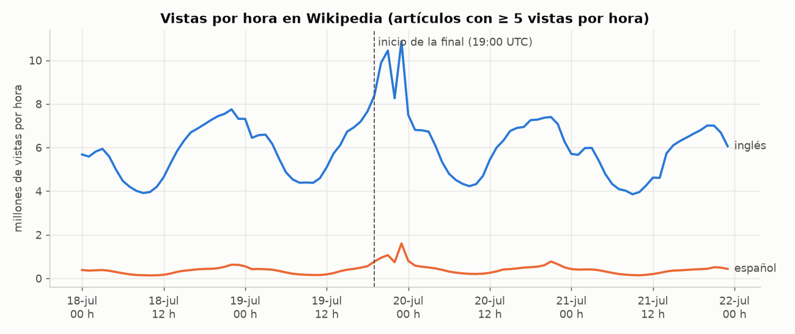
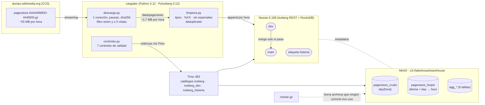
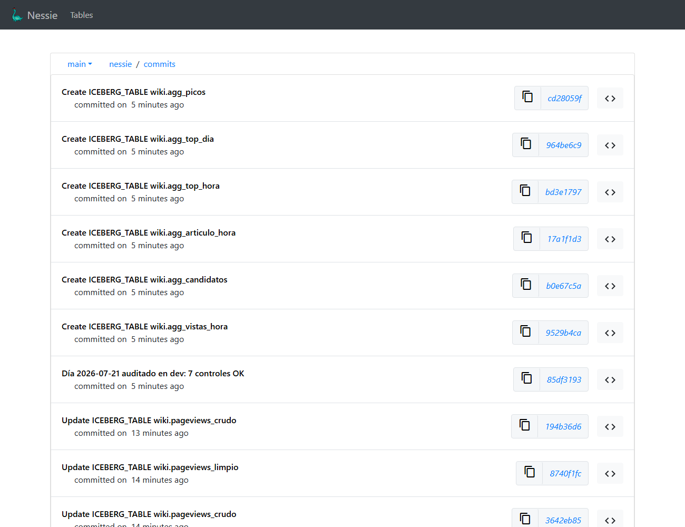
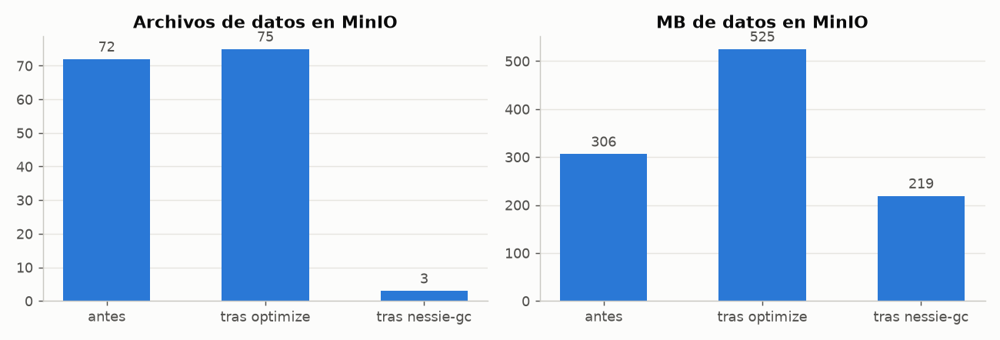
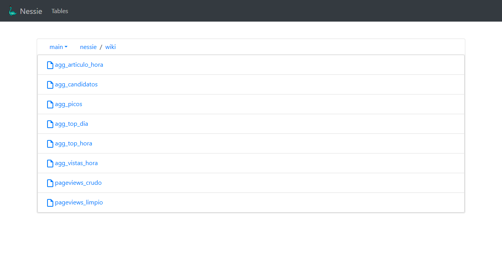
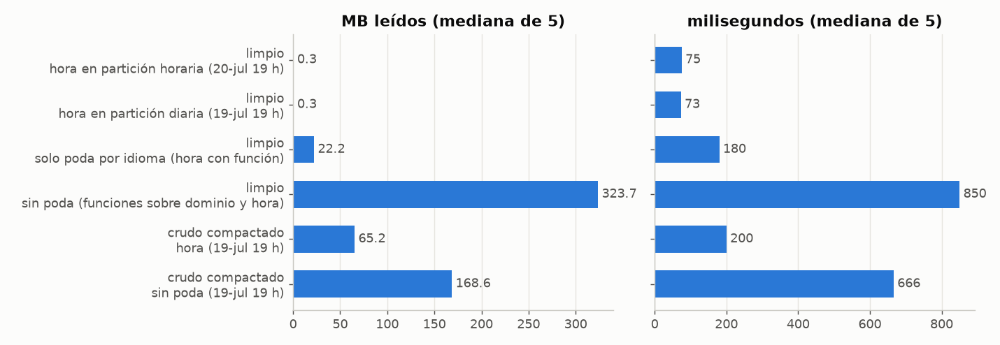
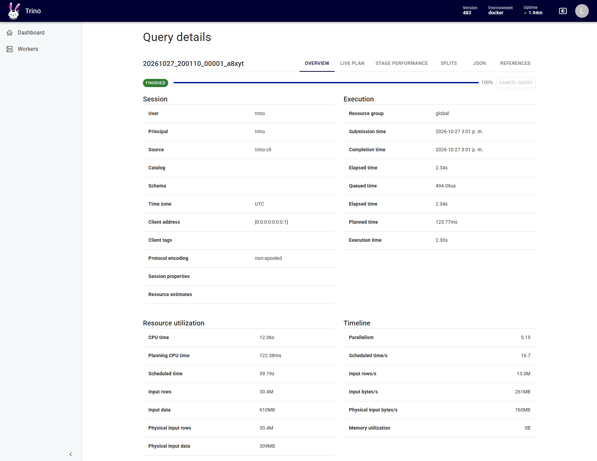
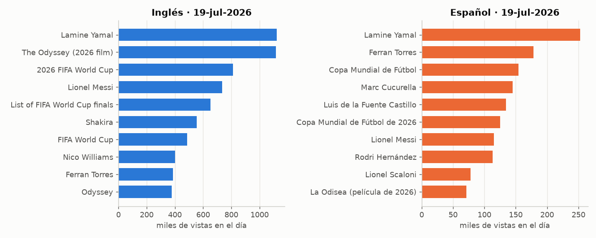
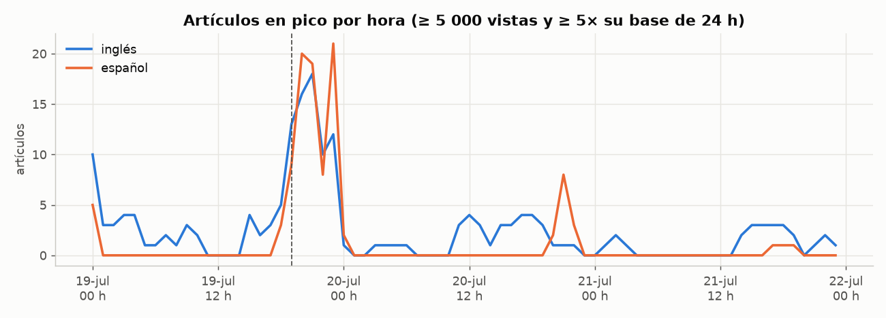

# 🧊 Lakehouse local con Apache Iceberg + Trino + Nessie sobre los pageviews de Wikipedia

[](https://github.com/GUAR-NIX/portafolio-cloud/actions/workflows/lakehouse-iceberg-trino-nessie.yml)


-7B42BC)


Lakehouse completo en Docker Compose: **MinIO** como S3, **Nessie** como catálogo Iceberg REST con ramas tipo git,
**Trino** como motor SQL y un **cargador en Python (PyIceberg)**. Ingiere **96 dumps horarios** de pageviews de
Wikipedia (18 al 21 de julio de 2026, alrededor de la **final del Mundial**), los filtra a Wikipedia en español e
inglés y los organiza en capas crudo → limpio → agregados. Encima se demuestra con evidencia lo que hace especial a
Iceberg: time travel, evolución de esquema y de particiones, compactación, y **write-audit-publish con ramas de
Nessie** (un día se carga en `dev`, se audita y solo se fusiona a `main` si pasa los controles).

**Problema de negocio.** Un equipo de contenidos quiere saber, hora a hora, qué artículos están en tendencia en cada
idioma y detectar picos de interés en cuanto ocurren. Necesita un almacén abierto (sin depender de un motor), barato
de consultar, donde un día mal cargado **nunca** llegue a los tableros y donde se pueda volver a cómo estaban los
datos ayer.

## Resultados (ejecución real, 27-oct-2026)

| | |
|---|---|
| **Datos** | 96 archivos horarios, **5.247 MB** descargados (594,8 M de líneas de todos los wikis) → **30,7 M de filas** es/en con ≥ 5 vistas por hora, **262 MB** filtrados (20× menos), con el **69,3 %** de las vistas es/en |
| **Capas** | crudo **30.677.014** filas · limpio **30.432.442** filas (614,3 M de vistas) · 6 tablas de agregados |
| **Time travel** | etiqueta de Nessie en el commit del 18-jul 23 h: **7.618.728** filas, frente a **15.263.513** en `main` en ese momento |
| **Esquema** | `ADD COLUMN lote` en **0,12 s**: 96 archivos y 161,0 MB **idénticos** antes y después (ningún archivo reescrito) |
| **Particiones** | de diaria a horaria sin reescribir: spec 0 (96 archivos, diaria) y spec 1 (48 archivos, horaria) conviven; las 2 consultas viejas dan **exactamente** el mismo resultado |
| **Compactación** | crudo: **72 → 3 archivos** (4,25 → 73 MB de promedio) en 21,8 s; MinIO 306 MB → 525 MB tras `optimize` → **219 MB** tras `nessie-gc` |
| **Ramas (WAP)** | día con defectos: **3 de 7 controles fallan** y `main` no cambia · día correcto: **7/7**, merge en **0,07 s** y `main` recibe 7.603.553 filas |
| **Poda** | una hora en español: **0,28 MB y 75 ms** con poda frente a **323,7 MB y 850 ms** sin poda (mediana de 5) |
| **Pruebas** | 32 pytest sin contenedores (limpieza, controles, descarga, cliente Nessie) + 1 de integración (rama → merge → Trino) · ruff · Terraform `fmt`/`validate` |
| **Memoria** | límites: Trino 3 GB, MinIO 1 GB, Nessie 1 GB, cargador 2 GB (máx. 7 GB); medido al final: Trino 1,8 GB, MinIO 0,7 GB, Nessie 0,5 GB |
| **Nube** | `terraform/aws`: S3 + Glue Data Catalog (Iceberg) + Athena · nunca `apply` · **~7 USD/mes** con 1 año de datos (supuestos abajo) |

> **Wikimedia regeneró estos dumps después de esta ejecución.** Los archivos de julio de 2026 se volvieron a publicar
> entre el 31-oct y el 1-nov-2026 (cabecera `Last-Modified`) y son más pequeños. Una corrida del 8-nov-2026 leyó
> 4.341 MB y 496,0 M de líneas (frente a 5.247 MB y 594,8 M) y guardó 30,3 M de filas (frente a 30,7 M). Las
> conclusiones no cambian: el mismo top 3 del día de la final, 19 o 20 de cada 20 artículos coinciden en cada
> ranking y todas las demostraciones dan el mismo resultado. Al reproducir el proyecto, las cifras exactas de esta
> tabla pueden diferir en unos pocos puntos porcentuales.



## Arquitectura



| Capa | Tabla | Partición | Filas | Contenido |
|---|---|---|---:|---|
| Crudo | `wiki.pageviews_crudo` | `day(hora)` | 30.677.014 | las líneas tal como llegan (texto), con archivo y número de línea |
| Limpio | `wiki.pageviews_limpio` | `idioma` + `day(hora)` → `hour(hora)` | 30.432.442 | tipado, título normalizado, sin especiales, deduplicado, plataforma |
| Agregados | `agg_vistas_hora` | `idioma` | 384 | vistas por hora, idioma y plataforma |
| | `agg_candidatos` · `agg_articulo_hora` | — · `idioma` + `day` | 67.467 · 5.163.393 | serie horaria exacta de los artículos con alguna hora ≥ 50 vistas |
| | `agg_top_hora` · `agg_top_dia` | — | 1.920 · 400 | top 10 por hora e idioma · top 50 por día e idioma |
| | `agg_picos` | — | 280 | hora con ≥ 5.000 vistas y ≥ 5× el promedio de las 24 h previas |

**Conciliación crudo → limpio** (`reports/carga/`): de 30.677.014 líneas se descartan 243.899 páginas que no son
artículos (`Special:`, `Usuario:`, portadas…; 45,8 M de vistas), 384 títulos `-` y se fusionan 289 filas que eran
el mismo artículo con dos grafías (`Caf%C3%A9` y `Café`): 30.677.014 − 243.899 − 384 − 289 = **30.432.442**.



## Lo que hace especial a Iceberg, con evidencia (`reports/iceberg/`)

### 1. Time travel: por commit de Nessie, no por snapshot

**Hallazgo.** Con Nessie como catálogo REST, la metadata de cada tabla guarda **solo el snapshot vigente**
(`snapshots_en_tabla_main = 1` después de ~100 commits); el historial vive en los commits de Nessie. Por eso
`FOR VERSION AS OF <snapshot del 18-jul>` falla con `Iceberg snapshot ID does not exists`, y el time travel se hace
apuntando a un commit:

1. Se recorre el historial de `main` y se busca el commit en que `pageviews_limpio` terminaba en la hora
   `2026-07-18T23:00` (propiedad `lakehouse.hora` del snapshot).
2. Se mueve la etiqueta `historia` a ese commit; Trino tiene un catálogo fijo `iceberg_historia` apuntando a ella.

| Consulta | Filas | Vistas | Hasta |
|---|---:|---:|---|
| `iceberg.wiki.pageviews_limpio` (main, en ese momento) | 15.263.513 | 316.670.305 | 19-jul 23 h |
| `iceberg_historia.wiki.pageviews_limpio` (etiqueta) | **7.618.728** | **146.328.747** | **18-jul 23 h** |

El top 5 en español también cambia: al cierre del 18-jul lideraba *La Odisea (película de 2026)*; con el día de la
final, *Lamine Yamal*. La etiqueta, además, protege esos archivos del recolector de basura (ver 4).

### 2. Evolución de esquema sin reescribir

`ALTER TABLE iceberg.wiki.pageviews_limpio ADD COLUMN lote varchar` tardó **0,12 s**. Antes y después: **96 archivos,
161.015.545 bytes**, mismas rutas. Las 15.263.513 filas viejas leen `lote = NULL`; el cargador detecta la columna y
la llena desde la carga siguiente (trazabilidad del lote). La etiqueta `historia` sigue mostrando el esquema viejo.

### 3. Evolución de particiones: de diaria a horaria

`ALTER TABLE ... SET PROPERTIES partitioning = ARRAY['idioma', 'hour(hora)']` antes de cargar el 20-jul:

| spec_id | Partición | Archivos | Filas | MB |
|---:|---|---:|---:|---:|
| 0 | `idioma`, `day(hora)` (18 y 19-jul) | 96 | 15.263.513 | 161,0 |
| 1 | `idioma`, `hour(hora)` (20-jul) | 48 | 7.565.376 | 80,1 |

Las consultas guardadas antes del cambio (vistas por día e idioma; top 5 en inglés durante la final) devuelven
**exactamente** lo mismo después. Trino planifica cada spec por separado. Una sola hora lee **3,77 MB** en la parte
diaria y **3,76 MB** en la horaria: como cada append del cargador escribe un archivo por hora, los **mínimos y máximos
de cada archivo** ya podaban por hora dentro de la partición diaria. La partición horaria es la que garantiza esa
poda cuando los archivos se compactan o se cargan en lotes grandes.

### 4. Compactación de archivos pequeños + limpieza de archivos viejos

Sobre `pageviews_crudo` (18–20 jul, un archivo por hora):

| Etapa | Archivos de la tabla | MB promedio | Objetos de datos en MinIO | MB en MinIO | Objetos de metadatos |
|---|---:|---:|---:|---:|---:|
| Antes | 72 | 4,25 | 72 | 306,4 | 217 |
| `ALTER TABLE ... EXECUTE optimize(file_size_threshold => '128MB')` (21,8 s) | **3** | 73,0 | 75 | 525,4 | 292 |
| `nessie-gc` (cutoff = ahora, 434 archivos borrados en ~3 s) | 3 | 73,0 | **3** | **219,1** | 75 |

Filas (23.014.078) y vistas (522.589.734) idénticas en las tres etapas. Los archivos compactados ocupan 29 % menos
que los pequeños: Parquet comprime mejor con grupos de filas más grandes.

**Por qué `nessie-gc` y no `expire_snapshots`.** Trino respondió `Cannot expire snapshots: GC is disabled (deleting
files may corrupt other tables)`: Nessie crea las tablas con `gc.enabled=false`, porque un archivo que ya no usa
`main` puede seguir siendo usado por otra rama o etiqueta. El equivalente correcto es `nessie-gc`: recorre **todas**
las referencias, marca lo vivo y borra lo demás (`reports/logs/nessie_gc.log`). Por la misma razón no se usa
`remove_orphan_files` de Trino, que solo ve la rama del catálogo.



### 5. Ramas de datos con Nessie: write-audit-publish

`scripts/ramas.py` carga el 21-jul en `dev`, calcula métricas con Trino (`iceberg_dev`) y las compara con los días
de `main` (`lakehouse/controles.py`, lógica probada con pytest):

| Control | Día con defectos | Día correcto |
|---|---|---|
| 24 horas presentes | ❌ 21 horas | ✅ 24 |
| sin duplicados (hora, dominio, título) | ❌ 274.207 filas repetidas | ✅ 0 |
| vistas > 0 y título no nulo | ✅ | ✅ |
| sin páginas que no son artículos | ❌ 50 filas `Special:` | ✅ 0 |
| volumen plausible (en) · 0,6–1,5× la mediana | ✅ 0,82× | ✅ 0,90× |
| volumen plausible (es) | ✅ 0,67× | ✅ 0,75× |
| idiomas completos | ✅ | ✅ |
| **Decisión** | **no se fusiona**; `dev` vuelve a `main` | **merge en 0,07 s** |
| Hash de `main` | `194b36d6…` antes y después | `194b36d6…` → `85df3193…` |
| Filas del 21-jul en `main` | 0 → 0 | 0 → 7.603.553 (limpio) y 7.662.936 (crudo) |

Los defectos inyectados simulan fallas reales: tres horas que no llegaron, una hora cargada dos veces y un proceso
que se saltó la limpieza. El merge es atómico y cubre las dos tablas a la vez: `main` nunca ve el crudo sin el
limpio.



## Rendimiento: con y sin poda (`reports/rendimiento.json`)

Misma consulta (top 10 de una hora en español) sobre 30,4 M de filas del limpio; mediana de 5 corridas tras una de
calentamiento:

| Caso | ms | MB leídos | Filas procesadas | Splits |
|---|---:|---:|---:|---:|
| limpio · hora en partición horaria (20-jul 19 h) | **75** | **0,28** | 26.019 | 35 |
| limpio · hora en partición diaria (19-jul 19 h) | 73 | 0,31 | 27.105 | 35 |
| limpio · solo poda por idioma (`date_format(hora)`) | 180 | 22,22 | 1.980.798 | 130 |
| limpio · sin poda (`substr(dominio)` y `date_format(hora)`) | **850** | **323,71** | 30.432.442 | 226 |
| crudo compactado · una hora (19-jul 19 h) | 200 | 65,25 | 7.711.580 | 35 |
| crudo compactado · sin poda | 666 | 168,58 | 30.677.014 | 61 |



- **1.150× menos bytes** con poda. Un filtro sobre la columna cruda (`hora = TIMESTAMP ...`) poda; envolverla en una
  función (`date_format(hora, ...)`) lo impide.
- Trino poda **particiones identidad aun con funciones** (`lower(idioma) = 'es'` podó) y usa los min/max de cada
  archivo: `dominio IN ('es', 'es.m')` también podó, porque cada archivo es de un solo idioma.
- **La compactación tiene un costo**: el crudo compactado mezcla 24 horas por archivo, así que una hora lee el día
  entero (65 MB, 7,7 M de filas). La solución es compactar ordenando por `hora` (`sorted_by`) o particionar por hora.

| Con poda (23,7 mil filas de entrada) | Sin poda (30,4 M de filas, 309 MB físicos) |
|---|---|
|  |  |

## Análisis de negocio (`reports/negocio/`)

**El día de la final (19-jul) sube el tráfico de Wikipedia** frente al 18-jul: +14,9 % en inglés (138,3 M → 158,9 M
de vistas) y **+42,2 % en español** (8,0 M → 11,4 M). El pico es a las 23 h UTC en inglés: 10,9 M de vistas en una
hora, frente a 6,1–7,3 M a la misma hora de los otros tres días. El móvil domina: 79–81 % en inglés y 91–93 % en español
durante el fin de semana, y baja a ~73 % y ~85 % el lunes y martes.



- **Tendencias (aumento del 19 frente al 18):** en inglés, *Lamine Yamal* (+916.821), *2026 FIFA World Cup*
  (+573.044) y *Lionel Messi* (+541.325); en español, *Lamine Yamal* (+211.226), *Ferran Torres* (+174.991) y
  *Copa Mundial de Fútbol* (+110.840).
- **Comparación entre idiomas:** 20 de los 50 artículos más vistos del 19-jul coinciden por título exacto en ambos
  idiomas (casi todos son nombres de personas). *Lamine Yamal* es el número 1 en los dos. Los artículos sobre el torneo
  no coinciden porque tienen otro título (*2026 FIFA World Cup* / *Copa Mundial de Fútbol de 2026*).
- **Picos con un evento real:** los artículos en pico pasan de 0–5 en una hora típica a **18 (inglés) y 21 (español)** en las
  horas de la final. El medio tiempo (21 h UTC) es el pico más claro: *Shakira* (439.605 vistas, 202× su base),
  *Justin Bieber*, *Madonna*, *BTS* y el director *Gustavo Dudamel* (188× en español). Antes del partido aparecen los
  artistas de la ceremonia (*Jennifer Hudson*, *Tom Cruise*, *Nicole Scherzinger*). El mayor pico fuera del Mundial
  es *Kevin Keegan* (20-jul 15 h, 708×). Ese caso muestra que el detector no depende del evento esperado.
- El artículo de la final suma 693.554 vistas en inglés (máximo de 57.550 en una hora, a las 23 h) y 97.436 en
  español.



## Decisiones

- **Iceberg y no Delta Lake.** Iceberg es un estándar abierto con un catálogo REST que entienden por igual Trino,
  Spark, Flink, PyIceberg, Snowflake, Athena y BigQuery. La partición es oculta (se consulta `hora`, no una columna
  derivada) y evoluciona sin reescribir. Delta funciona muy bien dentro de Databricks y Spark, pero sus
  particiones son columnas físicas y cambiarlas obliga a reescribir.
- **Nessie como catálogo.** Aporta lo que un catálogo Hive o Glue no tiene: commits que abarcan varias tablas,
  ramas, etiquetas y merge, que permiten write-audit-publish sin copiar datos. Se usa en modo **catálogo REST**:
  Nessie escribe la metadata en MinIO y los clientes (PyIceberg y Trino) solo necesitan la URI
  `.../iceberg/<rama>`.
- **PyIceberg para cargar y Trino para todo lo demás.** La limpieza es Python puro (se prueba sin contenedores) y
  cada hora se escribe con un `append` atómico. Las transformaciones de conjunto (agregados, compactación, DDL) son
  SQL en Trino.
- **Idempotencia leyendo los datos.** Al principio se marcaba cada hora en las propiedades del snapshot, pero con
  Nessie solo sobrevive el snapshot vigente. El cargador ahora lee las horas presentes en la columna `hora` de la
  rama (barato: es casi constante por archivo).
- **Filtro de volumen en la descarga.** Se guardan solo las filas con ≥ 5 vistas en la hora: es el 5,2 % de las
  líneas de origen y conserva el 69,3 % de las vistas es/en. En una hora de muestra, la cola larga (1–4 vistas) era el 86 % de las
  filas de es/en; no cambia ningún top ni ningún pico. Así el proyecto cabe en un portátil (262 MB en disco).
- **Corte de candidatos verificado.** Los tops se calculan solo sobre artículos con alguna fila ≥ 50 vistas, y
  `scripts/agregados.py` comprueba que es exacto: el puesto 10 por hora tiene 508 vistas (un no candidato suma como
  máximo 98) y el puesto 50 por día tiene 8.143 (como máximo 2.352).
- **Respeto al servidor de Wikimedia.** Una sola conexión, pausa entre archivos, reintentos con espera creciente y
  User-Agent propio. La descarga de la hora siguiente se solapa con el procesamiento de la actual, sin abrir una
  segunda conexión.

## Limitaciones

- **Las vistas son de artículos con ≥ 5 vistas por hora.** Los totales por idioma no son el tráfico total de
  Wikipedia: en español el umbral recorta más, porque su cola larga pesa más.
- **Solo tráfico de usuarios.** Los dumps de pageviews excluyen arañas y tráfico marcado como automatizado, aunque
  queda algo de tráfico automatizado que no se detecta.
- **Nessie REST guarda un solo snapshot por tabla.** El time travel por `snapshot_id` de Iceberg no está disponible;
  se usa `rama@hash` o etiquetas, y la retención la decide `nessie-gc`, no `expire_snapshots`.
- El cargador hace **un commit por tabla** (PyIceberg no expone transacciones de varias tablas de Nessie). Si se cae
  entre las dos, el siguiente arranque solo completa la tabla que falta. El merge de la rama sí es atómico.
- Trino corre en **un solo nodo** con 2 GB de heap; las cifras de tiempo son de un portátil y sirven para comparar
  casos entre sí, no como referencia absoluta.
- El costo en la nube es una **estimación con precios de lista** y supuestos propios; no se desplegó nada.

## Nube: Terraform de referencia (no aplicado) y costo

`terraform/aws/` traduce el lakehouse a AWS: **S3** (con bloqueo de acceso público, cifrado y ciclo de vida),
**Glue Data Catalog** con tablas Iceberg v2 y un **workgroup de Athena** (motor v3, con corte de 10 GB por consulta)
con consultas guardadas para `OPTIMIZE` y `VACUUM`. Se validó con la imagen `hashicorp/terraform:1.13`
(`reports/logs/terraform_validate.log`): `fmt -check` y `validate` OK, **nunca `apply`**. Glue no tiene ramas:
para write-audit-publish en AWS se usan las ramas de Iceberg (`branch`/`fast_forward`) o una tabla de staging.

| Escenario (`scripts/costo_nube.py`) | GB en S3 | S3 | Athena | Fargate (cargador) | Glue | **Total/mes** |
|---|---:|---:|---:|---:|---:|---:|
| Prueba: 1 mes de datos, 3.000 consultas de tablero y 50 de análisis | 7,0 | 0,22 | 0,72 | 0,20 | 0 | **≈ 1,1 USD** |
| Producción: 1 año de datos, 30.000 de tablero y 300 de análisis | 84,8 | 2,10 | 4,88 | 0,20 | 0 | **≈ 7,2 USD** |

Supuestos: ~172 MB/día de Iceberg más 66 MB/día de dumps filtrados (medidos aquí); S3 Standard a 0,023 USD/GB-mes;
Athena a 5 USD/TB con mínimo de 10 MB por consulta; consulta de tablero = una hora podada; consulta de análisis =
30 días del limpio sin poda horaria; cargador en Fargate con 0,5 vCPU y 1 GB, 40 s por hora; Glue dentro del nivel
gratuito. **Lo que más mueve el costo es Athena**: una consulta de análisis (30 días sin poda horaria, ~2,4 GB) escanea
~240× lo que se cobra por una de tablero (mínimo de 10 MB).

## Cómo reproducir

Requisitos: Docker con ~7 GB de RAM libres, ~2 GB de disco (imágenes y datos) y Python 3.12+ para las pruebas.

```bash
docker compose build                 # compila MinIO desde el código fuente (no hay imagen oficial) y el cargador
docker compose up -d --wait          # MinIO + bucket, Nessie (rama dev, etiqueta historia) y Trino
sh scripts/ejecutar_todo.sh          # carga, demostraciones, agregados, rendimiento y análisis (~1,5 h, reanudable)
```

Para el GC de Nessie (entre `compactacion` y `compactacion_final`), ver el comando en
[docs/GUIA_PASO_A_PASO.md](docs/GUIA_PASO_A_PASO.md).

- Consola de Nessie: <http://localhost:19120> · Trino: <http://localhost:8080/ui/> · MinIO: <http://localhost:9001>
  (`minioadmin`/`minioadmin`, credenciales **solo locales**).
- Consultar a mano: `docker compose exec trino trino`, por ejemplo
  `SELECT * FROM iceberg.wiki.agg_top_dia WHERE dia = DATE '2026-07-19' AND idioma = 'es' ORDER BY puesto;`
- Pruebas unitarias (sin contenedores): `pip install -r requirements-dev.txt && ruff check . && pytest -q`
- Prueba de integración (con el compose arriba): `sh scripts/prueba_integracion.sh`
- Apagar: `docker compose down` (los datos quedan en los volúmenes `minio-datos` y `nessie-datos`; `down -v` los
  borra).

```
lakehouse/          descarga · limpieza · controles · nessie (cliente API v2) · tablas · catalogo · consultas
scripts/            cargar · demos_iceberg · ramas · agregados · rendimiento · analisis · costo_nube · descargar
sql/agregados.sql   capa de agregados (Trino)
trino/              catálogos iceberg (main), iceberg_dev (dev), iceberg_historia (etiqueta) y JVM
terraform/aws/      S3 + Glue (Iceberg) + Athena, solo validate
tests/              32 unitarias + test_integracion.py (marcada `integracion`)
reports/            iceberg/ · carga/ · negocio/ · figures/ · capturas/ · logs/ y JSON de resultados
```

## Fuente y licencia

- **Datos:** [Wikimedia pageviews](https://dumps.wikimedia.org/other/pageviews/), publicados por la Wikimedia
  Foundation bajo **CC0 1.0** (dominio público), sujetos a los
  [términos de uso de Wikimedia](https://foundation.wikimedia.org/wiki/Policy:Terms_of_Use). La descarga sigue
  la política de User-Agent y la recomendación de no abrir conexiones en paralelo. Los dumps no se versionan.
- **Código:** licencia MIT (ver `LICENSE`). Los datos conservan su propia licencia.
