# 🌦️ Modern data stack local: Dagster + dbt + DuckDB + MinIO sobre NOAA GHCN-Daily

[](https://github.com/GUAR-NIX/portafolio-cloud/actions/workflows/modern-data-stack-dagster-dbt.yml)


-7B42BC)


Pipeline orquestado **por activos** que ingiere **177,5 millones de observaciones diarias** de ~45.000 estaciones
meteorológicas del mundo (NOAA GHCN-Daily, años **2022–2026**, 6,4 GB de CSV), las guarda en un lago tipo S3
(MinIO, Parquet) y las transforma con **dbt** en un almacén **DuckDB** hasta publicar indicadores de clima
mensuales por estación y por país, anomalías frente a una normal y extremos, con **45 controles de calidad** y
linaje de punta a punta. Incluye Terraform de referencia para GCP (solo `fmt` y `validate`).

**Problema de negocio.** Un servicio meteorológico necesita un pipeline mantenible que, cada día, traiga los datos
nuevos de miles de estaciones, descarte los valores que no pasan los controles de NOAA, y publique indicadores por
país confiables: con pruebas que detengan la publicación si algo está mal, linaje para saber de dónde sale cada
número y la posibilidad de reprocesar cualquier año sin tocar los demás.

| | |
|---|---|
| **Orquestación** | Dagster 1.13 (webserver + daemon) en Docker Compose · 4 activos Python + 10 modelos dbt como activos (dagster-dbt) |
| **Backfill real** | 5 particiones anuales (2022–2026), **5/5 en verde**, 6,1 min de corridas en total (74 s por año en promedio) |
| **Almacenamiento** | CSV 6.388 MB → `.csv.gz` 813 MB → **Parquet 171 MB** en MinIO (37× menos que el CSV) |
| **Transformación** | dbt build: **10 modelos + 37 pruebas en verde y 2 advertencias** en 150 s sobre 94 M de filas |
| **Calidad** | 5 asset checks bloqueantes por año + 39 pruebas dbt + 1 check de negocio + *freshness* de la fuente |
| **Pruebas** | 16 pytest (descarga reanudable, conversión, controles, Dagster sin red) + dbt build sobre una muestra en la CI |
| **Nube** | `terraform/gcp`: GCS + BigQuery + Cloud Run job + Cloud Scheduler · `fmt` y `validate` OK, nunca `apply` |
| **Memoria** | ≤ 7,5 GB en total (MinIO 1 GB, webserver 1,5 GB, daemon 5 GB); pico medido del daemon: 3,5 GB |

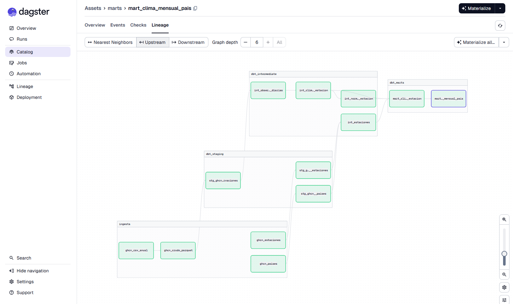

## Arquitectura

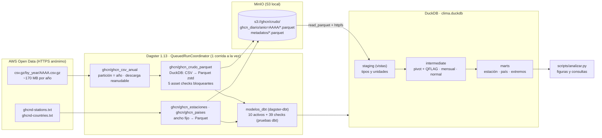

**Linaje en dbt docs** (`dbt docs generate`):

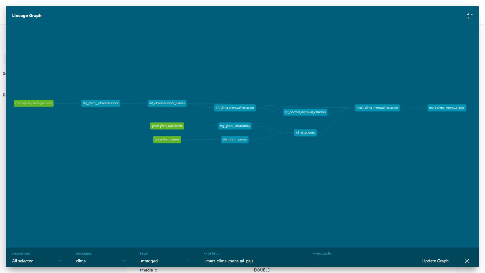

## Resultados (ejecución real, 25-oct-2026)

### Backfill por año (partición de Dagster)

| Año | Filas crudas | Estaciones | CSV (MB) | .csv.gz (MB) | Parquet (MB) | Descarga (s) | CSV → Parquet + checks (s) | Corrida completa (s) |
|---|---:|---:|---:|---:|---:|---:|---:|---:|
| 2022 | 38.181.174 | 43.836 | 1.372,3 | 175,6 | 37,0 | 23,8 | 30,9 | 76,3 |
| 2023 | 38.293.556 | 44.415 | 1.376,3 | 176,0 | 36,7 | 23,3 | 44,6 | 88,6 |
| 2024 | 38.470.116 | 44.882 | 1.383,4 | 176,5 | 37,0 | 14,2 | 31,9 | 67,0 |
| 2025 | 36.371.852 | 44.531 | 1.310,9 | 166,0 | 34,8 | 28,0 | 37,8 | 79,4 |
| 2026 (al 22-oct) | 26.178.186 | 39.717 | 944,9 | 118,5 | 25,1 | 18,3 | 20,8 | 57,3 |
| **Total** | **177.494.884** | | **6.387,8** | **812,6** | **170,6** | | | **368,6** |

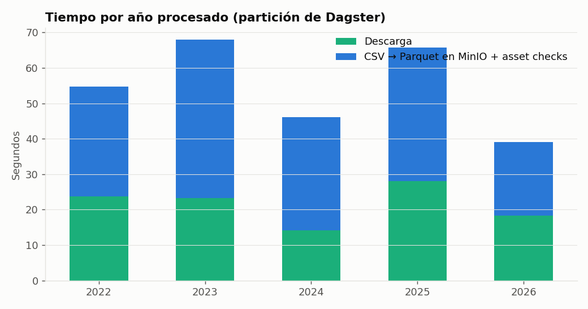 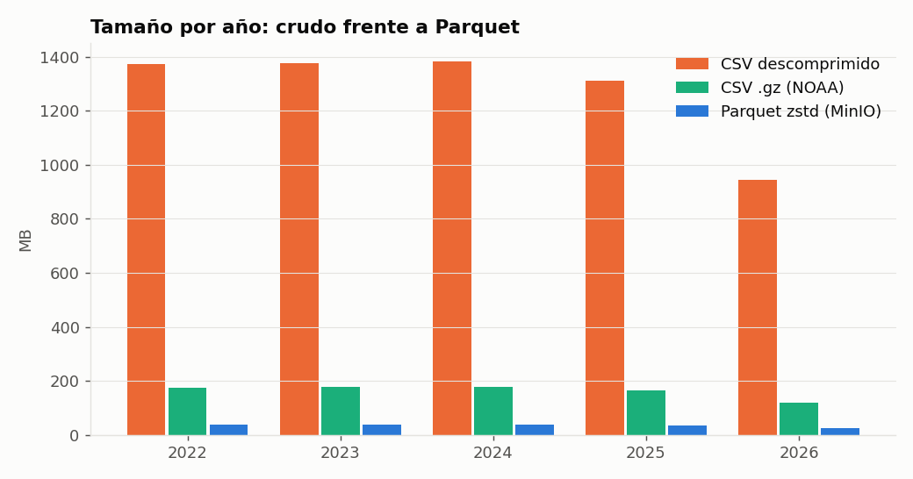

- **Parquet ordenado por elemento y estación** ocupa 4,8× menos que el `.csv.gz` original y 37× menos que el CSV:
  los valores consecutivos de una misma estación se parecen y zstd los comprime muy bien.
- **Misma consulta, mismo motor** (TMAX media por mes de 2025 en DuckDB): **12,54 s** sobre el `.csv.gz` frente
  a **0,14 s** sobre el Parquet en MinIO, porque solo se leen 4 columnas y los grupos de filas de TMAX.
- La "corrida completa" incluye el arranque del proceso de Dagster y la medición del tamaño descomprimido (~5 s).
  Los tiempos por paso de 2025 son los de su re-materialización tras la demostración de la falla (abajo).
- El año en curso (2026) llega hasta el **22-oct-2026**: la *freshness* de dbt lo da por bueno (95 h de antigüedad;
  advierte a los 5 días y falla a los 15).

### Filas por capa

| Capa | Objeto | Filas |
|---|---|---:|
| Crudo (MinIO) | `ghcn/ghcn_crudo_parquet` (todos los elementos) | 177.494.884 |
| Staging | `stg_ghcn__observaciones` (TMAX, TMIN, PRCP en °C y mm) | 94.363.937 |
| Intermediate | `int_observaciones_diarias` (pivot estación-día, sin valores con QFLAG) | 57.941.103 |
| Intermediate | `int_clima_mensual_estacion` · `int_normal_mensual_estacion` | 2.239.194 · 136.689 |
| Intermediate | `int_estaciones` (catálogo + país) | 133.039 |
| Marts | `mart_clima_mensual_estacion` | 2.239.194 |
| Marts | `mart_clima_mensual_pais` | 9.713 |
| Marts | `mart_extremos_pais_anual` | 889 |

El filtro de calidad descartó **109.833 valores** con bandera QFLAG (fallaron algún control de NOAA). El almacén
DuckDB ocupa 2.013 MB (en un volumen Docker, no versionado).

### Calidad: qué se prueba y qué pasó

| Dónde | Controles | Resultado |
|---|---|---|
| Asset checks de `ghcn_crudo_parquet` (por año, **bloqueantes**) | ≥ 1 M de filas · fechas dentro del año · sin nulos en claves · TMAX/TMIN/PRCP presentes · TMAX/TMIN válidas entre −90 y 60 °C | 25/25 en el backfill; 1 falla provocada (abajo) |
| Pruebas dbt (39) | `not_null`, `unique`, `accepted_values` (elementos, QFLAG, meses), `relationships`, rango físico (propia), clave compuesta (propia), TMAX ≥ TMIN (`warn`), conciliación mart país ↔ estación | **37 pass · 2 warn · 0 error** |
| Check de negocio en Dagster | `mart_pais_plausible`: ≥ 100 países y ninguna anomalía país-mes > 15 °C | pass |
| `dbt source freshness` | último dato ≤ 5 días (warn) / 15 días (error) | pass (95 h) |

**Las 2 advertencias son un hallazgo real.** En la primera corrida, la prueba `relationships` entre observaciones y
catálogo **falló con 648 filas**: dos estaciones de EE. UU. (`USW00000462`, `USW00054760`) reportan desde el
12-oct-2025, pero NOAA todavía no las agregó a `ghcnd-stations.txt`. No es un error del pipeline sino un desfase
de la fuente, así que la prueba quedó en `warn` si hay huérfanos y `error` si pasan de 1.000 filas; los marts usan
`left join` y conservan esos datos con nombre vacío.

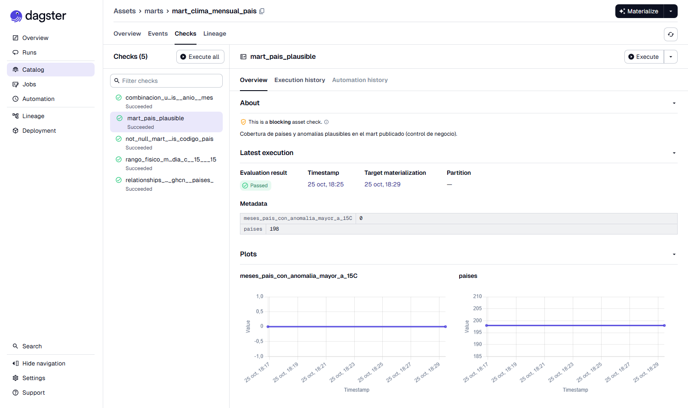

### Un asset check que falla (demostración)

Se materializó la partición 2025 con `simular_datos_malos: true` (pone 999,9 °C en ~2 % de las TMAX).
El check `temperatura_en_rango_fisico` encontró **82.909 filas fuera de rango**, la corrida quedó en rojo con
`DagsterAssetCheckFailedError` y, por ser bloqueante, nada aguas abajo se recalculó con esos datos
([log](reports/logs/asset_check_fallido_2025.log), [métricas](reports/ingesta/crudo_2025_datos_malos.json)).
Re-materializar la partición sin la configuración la devolvió a verde (0 filas fuera de rango): el gráfico del
check muestra el pico y la recuperación.

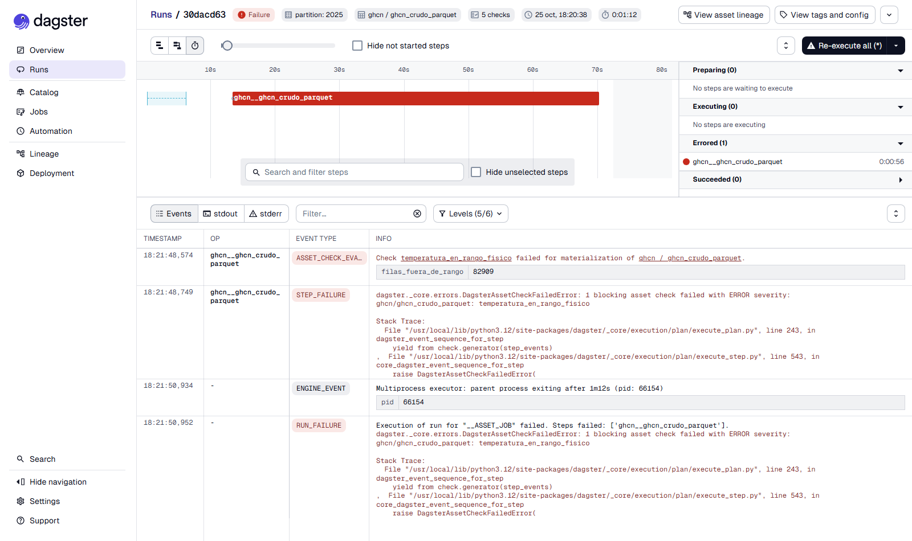
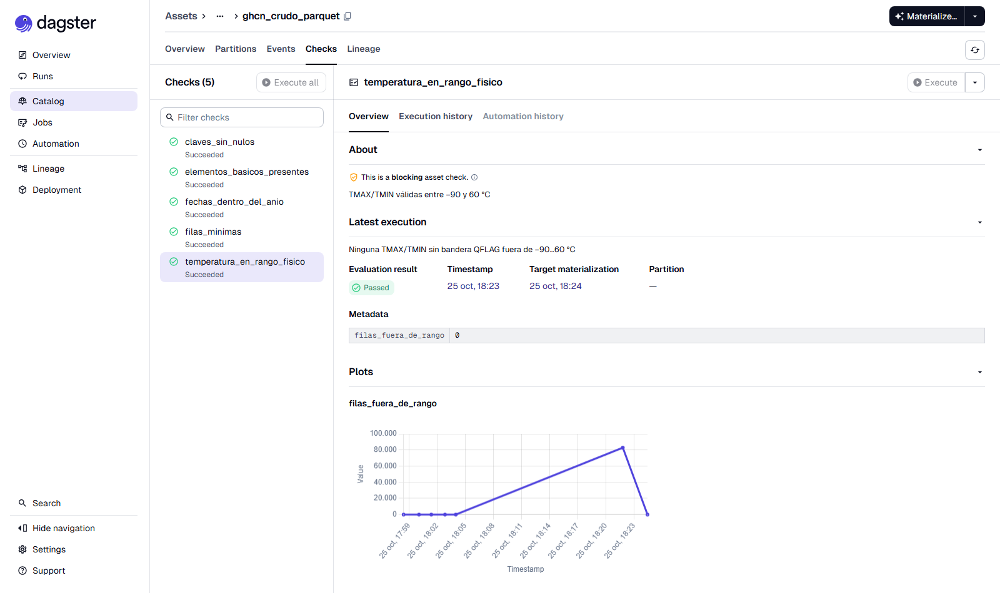

### Consultas de negocio

**Anomalía de 2025 por país** (39 países con ≥ 10 meses con anomalía y ≥ 3 estaciones por mes; normal = promedio
2022-2024 de cada estación y mes). Mediana entre países: **−0,01 °C**. Los más cálidos: Islandia (+1,25 °C),
Kirguistán (+1,17), Groenlandia (+1,03), Finlandia (+0,90), Suecia (+0,87); los más fríos: Sudáfrica (−0,85),
Austria (−0,82), Armenia (−0,74), Alemania (−0,64), Tailandia (−0,60).

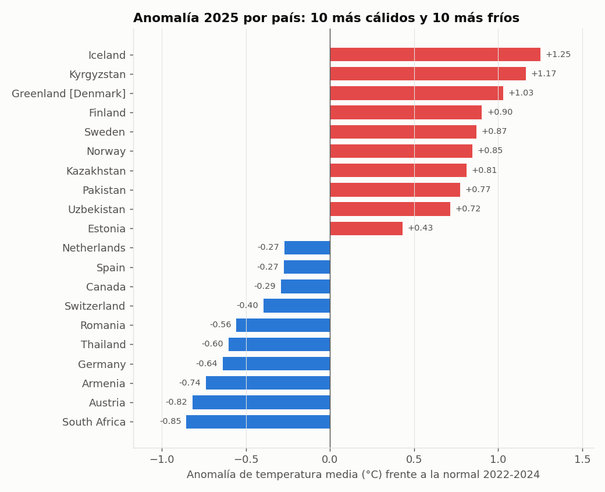

**Serie mensual.** El mes más cálido frente a la normal fue **marzo de 2026: +2,42 °C promediando estaciones**,
pero solo +0,18 °C promediando países: EE. UU. aporta ~6.800 de las ~9.900 estaciones con anomalía y domina el
primer promedio. Por eso el mart por país promedia estaciones *dentro* de cada país.

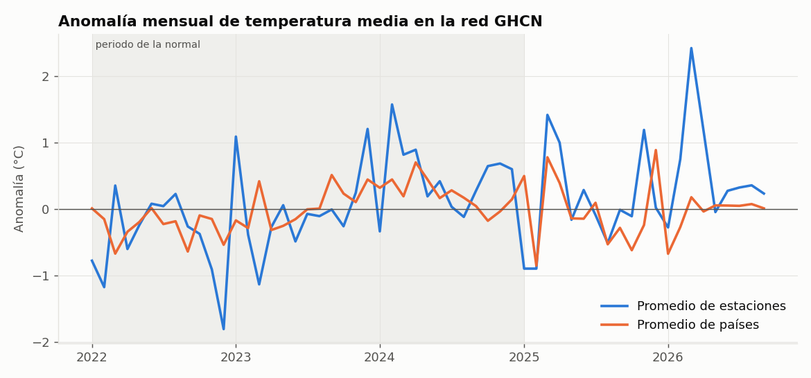

**Extremos de 2025** (valores con QFLAG vacía): máxima de **51,6 °C en Abadán (Irán, 17-jul)**, 51,1 °C en Death
Valley (EE. UU., 14-jul) y 50,5 °C en Shahbaz (Pakistán, 13-jun); mínima de **−80,2 °C en Vostok (Antártida,
9-jul)** y −58,7 °C en Tegjultja (Rusia, 1-ene). Tabla completa en [extremos_pais_2025.csv](reports/extremos_pais_2025.csv).

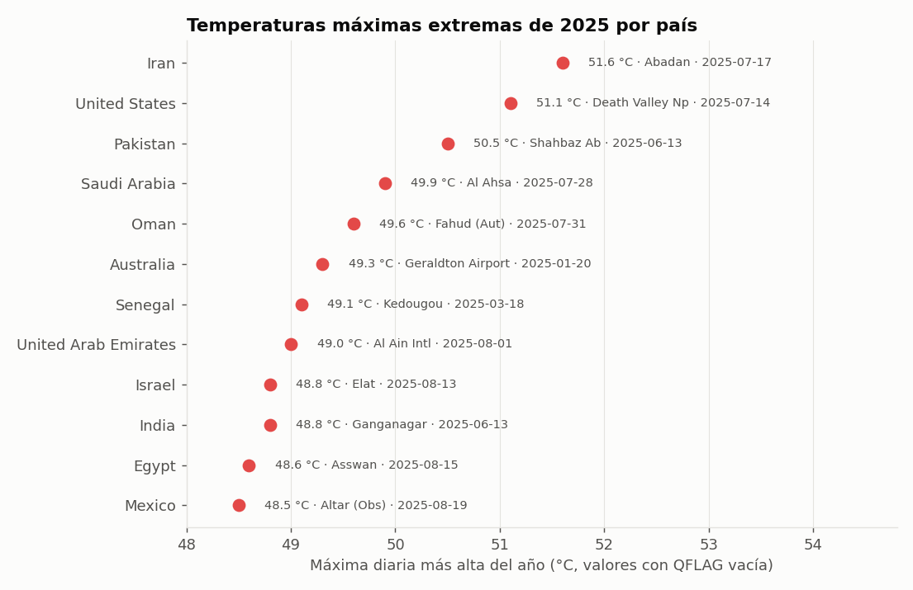

### Línea base ingenua

Comparación contra lo más simple: restar la media de **todas** las estaciones que reportaron en 2025 menos la de
2022-2024, sin emparejar estaciones. En 14 países con ≥ 20 estaciones, la diferencia frente a la anomalía del mart
tiene mediana **0,09 °C** y máximo **0,70 °C (China)**: con la ingenua China parece 0,70 °C más cálida, con la del
mart está en 0,00 °C. La diferencia viene de las estaciones que entran y salen de la red, no del clima
([linea_base_ingenua.csv](reports/linea_base_ingenua.csv)).

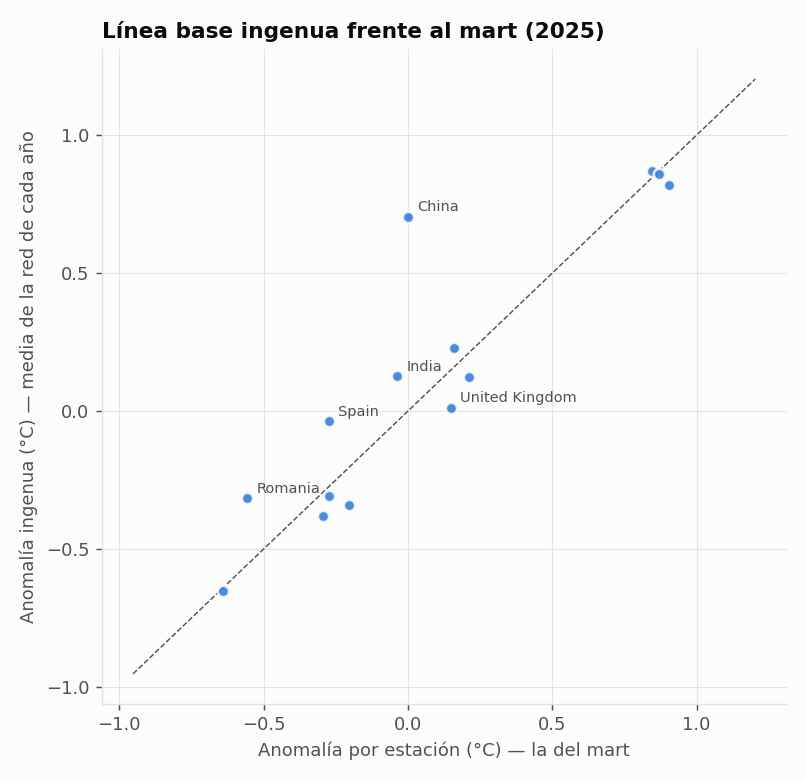

### Ecuador en GHCN: una limitación de la fuente

| Año | Estaciones | Días-estación con TMAX | Con TMIN | Con PRCP |
|---|---:|---:|---:|---:|
| 2022 | 10 | 1.172 | 1.019 | 774 |
| 2023 | 9 | 1.192 | 1.088 | 871 |
| 2024 | 9 | 621 | 619 | 458 |
| 2025 | 9 | 274 | 263 | 164 |
| 2026 | 7 | 1 | 1 | 516 |

Ninguna estación ecuatoriana completa un mes con 20 días de TMAX y TMIN, así que Ecuador **no tiene anomalías**
en el mart. Un servicio que quiera publicar Ecuador tendría que sumar la red del INAMHI como otra fuente
([cobertura_ecuador.csv](reports/cobertura_ecuador.csv)).

### Capturas de Dagster

| Particiones por año | Backfill y corridas |
|---|---|
| 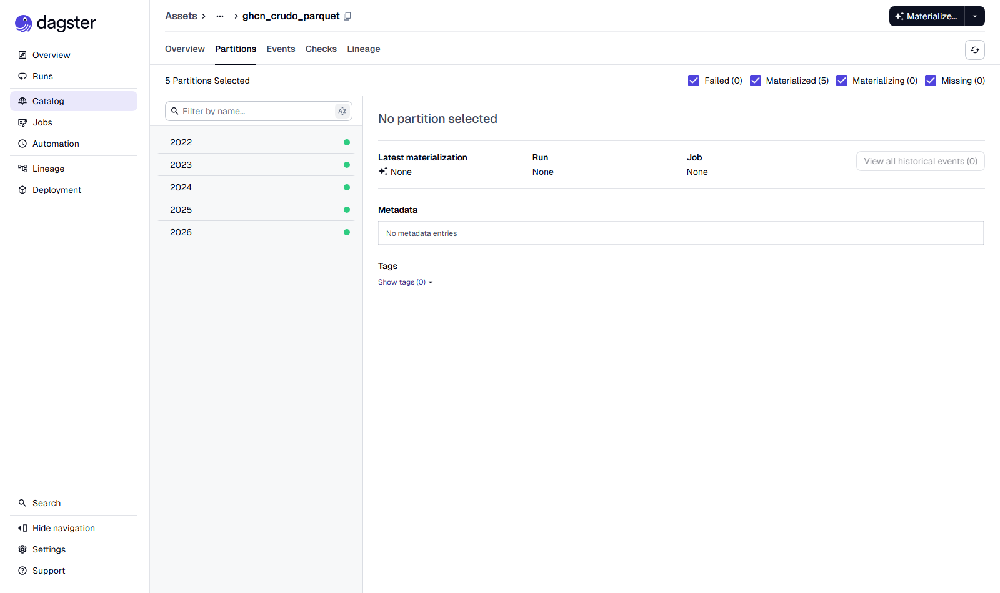 | 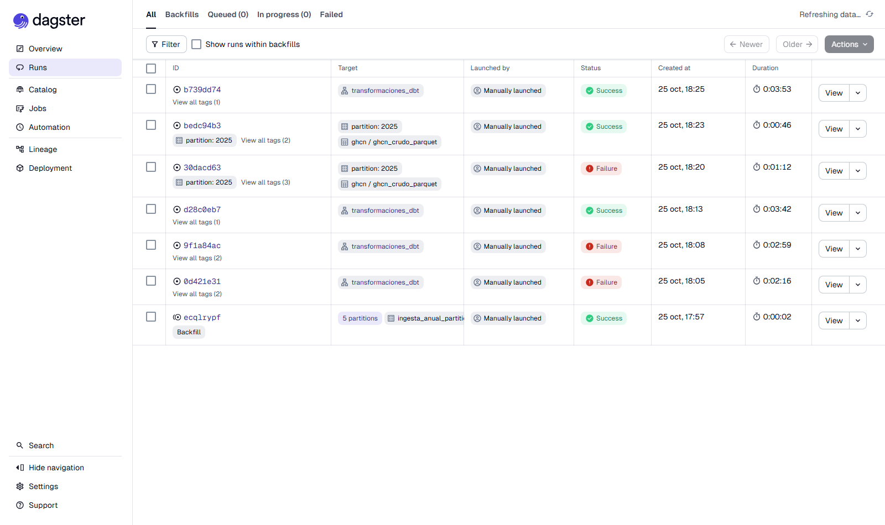 |

## Decisiones técnicas

- **Dagster (activos) en vez de Airflow (tareas):** el producto son tablas; Dagster las modela como activos con
  particiones, checks y linaje nativos, y `dagster-dbt` convierte cada modelo en activo y cada prueba en check.
  (El proyecto hermano `airflow-apis-postgres` muestra Airflow.)
- **Partición por año:** coincide con el archivo que publica NOAA; los años cerrados no se tocan y el año en curso
  se refresca con el schedule `ingesta_diaria_anio_en_curso` (06:00, detenido por defecto) seguido de
  `transformaciones_diarias` (07:00).
- **DuckDB para convertir y para el almacén:** lee `.csv.gz` y escribe Parquet directo en MinIO (`httpfs`) con
  memoria acotada (2,5 GB al convertir, 3 GB en dbt) y derrame a disco; no hace falta Spark para 177 M de filas.
- **Staging como vistas sobre MinIO:** no se duplica el crudo; el Parquet ordenado por elemento permite que el
  filtro `elemento in ('TMAX','TMIN','PRCP')` salte grupos de filas.
- **Una corrida a la vez:** DuckDB tiene un solo escritor y la PC comparte RAM con otros proyectos.
- **Checks bloqueantes en la ingesta:** un año corrupto no llega a dbt. dbt agrega las pruebas de modelo y una
  conciliación entre marts.
- **Anomalía por estación:** elimina el sesgo de composición de la red (ver línea base). El mes en curso no
  cuenta como completo aunque tenga 20 días, porque compararlo con la normal del mes entero lo sesga.
- **MinIO compilado desde el código fuente** (`docker/minio`): desde fines de 2025 MinIO no publica imágenes en
  Docker Hub.

## Limitaciones

- La **normal es de 3 años (2022-2024)**, no la de 30 años de la OMS; sirve para comparar 2025-2026 fuera de la
  muestra, no para hablar de cambio climático. Ampliarla es cambiar `ANIOS` y las variables `anio_normal_*`.
- El indicador por país es el **promedio simple de estaciones**, sin ponderar por área: en países con redes
  densas en una región (EE. UU., Canadá, Australia) pesa más esa región.
- Solo TMAX, TMIN y PRCP; la temperatura media es (TMAX + TMIN) / 2, no TAVG.
- Los valores sin bandera QFLAG pueden tener errores que NOAA no detectó; las pruebas de rango solo atrapan los
  imposibles.
- El almacenamiento de la instancia de Dagster es SQLite (adecuado para una PC; en producción, Postgres).

## Cómo reproducirlo

Requisito: Docker Desktop. Detalle y preguntas de entrevista en la [guía paso a paso](docs/GUIA_PASO_A_PASO.md).

```powershell
docker compose build
docker compose up -d                                            # http://localhost:3000 (Dagster) · :9001 (MinIO)
docker compose exec dagster-daemon dagster job backfill -w workspace.yaml -j ingesta_anual --partitions 2022,2023,2024,2025,2026 --noprompt
docker compose exec dagster-daemon dagster job launch -w workspace.yaml -j transformaciones_dbt
docker compose exec dagster-daemon sh -c "cd dbt_clima && dbt source freshness --profiles-dir . && dbt docs generate --profiles-dir ."
docker compose exec dagster-daemon python scripts/analizar.py   # reports/*.json|csv + reports/figures
docker compose down
```

Pruebas como en la CI (sin MinIO ni internet, sobre `data/muestra`: 118.047 filas de 36 estaciones, 205 KB):

```powershell
docker compose run --rm --no-deps -e DBT_TARGET=ci -e UBICACION_CRUDO=/opt/proyecto/data/muestra dagster-webserver sh -c "cd dbt_clima && dbt build --profiles-dir . && cd .. && ruff check src tests scripts descargar_datos.py && pytest -rs"
```

Resultado local: dbt build sobre la muestra **49/49 PASS**, ruff sin errores y **16 pytest pasan**
([log](reports/logs/ci_local.log)). Terraform: [fmt y validate](reports/logs/terraform_validate.log).

## Estructura

```
modern-data-stack-dagster-dbt/
├── docker-compose.yml · docker/ (Dockerfile, dagster.yaml, minio/) · workspace.yaml
├── LICENSE
├── src/clima_mds/          activos Dagster, descarga reanudable, DuckDB/MinIO, controles de calidad
├── dbt_clima/              proyecto dbt (staging, intermediate, marts, pruebas propias, perfiles dev/ci)
├── scripts/                analizar.py, crear_muestra.py, capturas_ui.ps1
├── data/raw/               csv.gz de NOAA (no se versiona) · data/muestra/ (Parquet para la CI)
├── reports/                metricas.json, consultas_negocio.json, ingesta/, dbt/, figures/, capturas/, logs/
├── terraform/gcp/          referencia GCP (no aplicada)
├── tests/                  pytest
└── (CI: ../.github/workflows/modern-data-stack-dagster-dbt.yml)
```


## Costo estimado en la nube (GCP, sin desplegar)

Estimación de orden de magnitud para el diseño de `terraform/gcp` (GCS + BigQuery + Cloud Run job + Cloud Scheduler).
**No se desplegó nada**: son cálculos con tarifas de lista de `us-central1` que conviene confirmar en la
[calculadora de Google Cloud](https://cloud.google.com/products/calculator) antes de decidir.

**Supuestos** (salen de las corridas medidas): el job de Cloud Run tiene 2 vCPU y 8 GiB (como en el Terraform) y
procesa el año en curso cada día: descarga + conversión a Parquet + dbt ≈ 3,5 min medidos (57 s de ingesta del año
2026 + 150 s de `dbt build`), que se redondean a **10 min** por ejecución para incluir el arranque. El lago ocupa
~1 GB (Parquet de 171 MB + metadatos + márgenes) y los marts ~0,2 GB. Consultas de negocio: pocas decenas al mes.

**Tarifas usadas (aprox.):** Cloud Run (job) 0,000024 USD por vCPU-segundo y 0,0000025 USD por GiB-segundo
(≈ 0,245 USD por hora de 2 vCPU + 8 GiB) · GCS Standard 0,020 USD/GB-mes · BigQuery 0,02 USD/GB-mes de
almacenamiento (10 GB gratis) y 6,25 USD/TB consultado (1 TB/mes gratis) · Cloud Scheduler 3 trabajos gratis ·
Artifact Registry 0,10 USD/GB-mes (0,5 GB gratis) · VM `e2-standard-2` ≈ 49 USD/mes.

| Escenario | Cómputo | Almacenamiento y consultas | Total aprox. |
|---|---:|---:|---:|
| **A. Una carga completa** (backfill 2022–2026 + dbt, ≈ 520 s en el job) | ≈ 0,04 USD | < 0,05 USD | **< 0,1 USD** |
| **B. Operación diaria sin orquestador permanente** (Cloud Scheduler → Cloud Run job, 30 ejecuciones de 10 min) | ≈ 1,2 USD/mes | GCS ≈ 0,02 · BigQuery dentro de la capa gratuita · imagen ≈ 0,1 | **≈ 1,5 USD/mes** |
| **C. Dagster encendido 24/7** (webserver + daemon en una VM `e2-standard-2` con disco de 30 GB) | ≈ 49 USD/mes + ≈ 1,2 USD de disco | igual que B | **≈ 50 USD/mes** (≈ 60 con una instancia pequeña de Cloud SQL para el almacén de Dagster) |

Lecturas para decidir:

- **Lo que cuesta es tener Dagster siempre encendido, no los datos**: 177 M de filas caben en 171 MB de Parquet y el
  trabajo diario dura minutos. Por eso el Terraform dispara un job con Cloud Scheduler en vez de una VM.
- **Quedarse en el job sin Dagster pierde linaje, particiones y checks en la interfaz**; es un compromiso de costo
  (B frente a C), no un cambio de diseño.
- **Hacer dbt sobre BigQuery en vez de DuckDB** movería el costo al escaneo: un supuesto de unos 20 GB por reconstrucción completa
  de los 10 modelos ≈ 0,12 USD por corrida, es decir < 4 USD/mes con una reconstrucción diaria (cubiertos hoy por el
  1 TB mensual gratuito, pero fuera de él se paga por TB).
- **No incluye** salida de red hacia Internet (la descarga desde AWS Open Data entra gratis), ni Cloud Logging por
  encima de la capa gratuita, ni el tiempo de quien lo opera.

## Fuente de datos y licencia

- **NOAA Global Historical Climatology Network – Daily (GHCN-Daily)**, versión 3, publicada en el
  [Registry of Open Data on AWS](https://registry.opendata.aws/noaa-ghcn/) (`s3://noaa-ghcn-pds`, acceso anónimo
  por HTTPS). Archivos: `csv.gz/by_year/2022…2026.csv.gz`, `ghcnd-stations.txt`, `ghcnd-countries.txt`.
- Cita: Menne, M. J. et al. (2012), *Global Historical Climatology Network – Daily (GHCN-Daily), Version 3*.
  NOAA National Centers for Environmental Information. doi:10.7289/V5D21VHZ.
- Licencia: datos del Gobierno de EE. UU., de dominio público y sin restricciones de uso (política de datos
  abiertos de NOAA).
- Descargados el **25-oct-2026** (2026 contiene datos hasta el 22-oct-2026).

**Licencia.** El **código** de este repositorio es MIT ([LICENSE](LICENSE)). Los **datos** no lo son: siguen la
licencia de su fuente, la que se cita arriba (datos de NOAA, dominio público).
