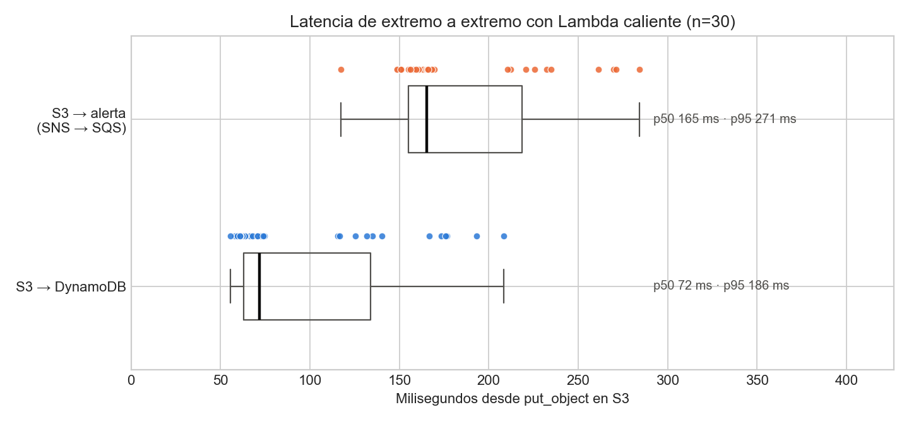
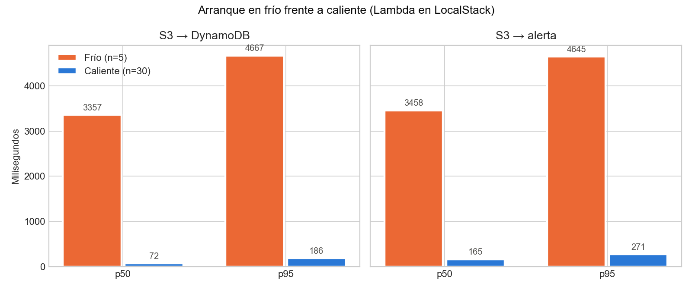
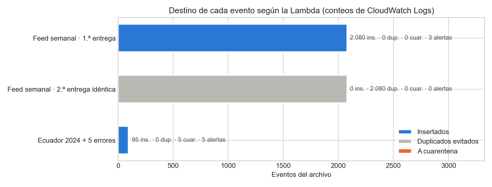
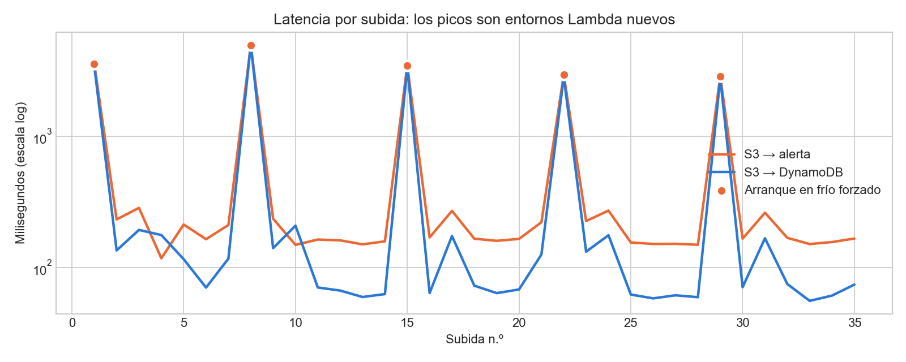
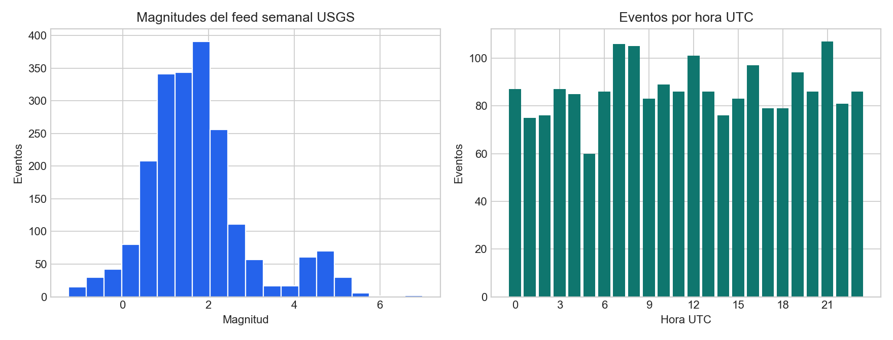
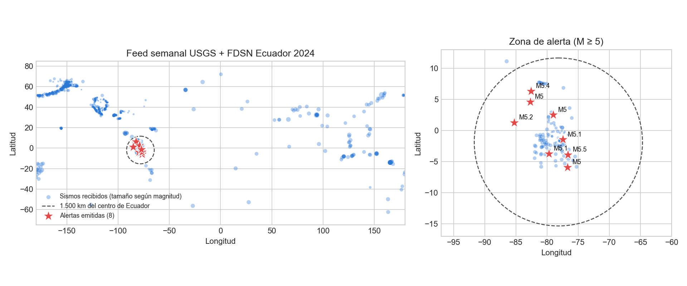
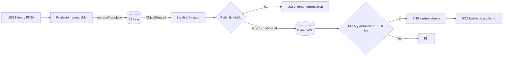

# 🌎 Alertas serverless de sismos · USGS → S3 → Lambda → DynamoDB → SNS

   

Pipeline orientado a eventos que valida GeoJSON del USGS, guarda cada sismo una sola vez y emite una alerta para
eventos de magnitud **≥ 5** a menos de **1.500 km** del centro de Ecuador. La arquitectura AWS se despliega con
Terraform sobre **LocalStack 4.8.1** en Docker; no requiere cuenta, credenciales reales ni gasto en nube.

## Resultados medidos (integración real en LocalStack)

Ejecución del 25-oct-2026 en Docker Desktop (Windows 11) con `scripts/medir_integracion.py`: cada archivo se sube
a S3, la notificación invoca la Lambda en su propio contenedor, que escribe en DynamoDB y publica en SNS; una cola
SQS suscrita al tema recibe las alertas. Datos reales: feed `all_week` (2.080 sismos) y la consulta FDSN de
Ecuador 2024 (100 sismos).

| Escenario | Recibidos | Insertados | Duplicados evitados | A cuarentena | Alertas en SQS |
|---|---:|---:|---:|---:|---:|
| Feed semanal, 1.ª entrega | 2.080 | 2.080 | 0 | 0 | 3 |
| Mismo archivo subido otra vez | 2.080 | 0 | **2.080** | 0 | 0 |
| Ecuador 2024 con 5 errores inyectados | 100 | 95 | 0 | **5** | 5 |

| Latencia de extremo a extremo (reloj del cliente) | n | p50 | p95 |
|---|---:|---:|---:|
| S3 → DynamoDB, Lambda caliente | 30 | **72 ms** | **186 ms** |
| S3 → alerta en SQS, Lambda caliente | 30 | **165 ms** | **271 ms** |
| S3 → DynamoDB, arranque en frío | 5 | 3.357 ms | 4.667 ms |
| S3 → alerta en SQS, arranque en frío | 5 | 3.458 ms | 4.645 ms |

- Al final de los tres escenarios DynamoDB tenía **2.080 ítems del feed** (más los 95 de Ecuador): la escritura
  condicional absorbió la repetición completa sin crear un solo duplicado ni repetir alertas.
- El lote de 2.080 eventos tardó **41,9 s** en quedar completo en DynamoDB (≈ 50 eventos/s con un `PutItem`
  por evento). Es el costo de escribir de a uno contra un emulador; en AWS se usaría `BatchWriteItem` o lotes por cola.
- Un arranque en frío cuesta **≈ 3,4 s** frente a **72 ms** en caliente: crear el contenedor de Lambda domina la
  latencia. El arranque en frío se forzó cambiando la configuración de la función antes de cada ronda.

Todo sale de [`reports/integracion_localstack.json`](reports/integracion_localstack.json), con cada medición
individual. [`reports/resultados.json`](reports/resultados.json) conserva la prueba en memoria (sin red): la misma
lógica procesa el feed en ~20 ms, de modo que casi toda la latencia medida es infraestructura.



| | |
|---|---|
|  |  |
|  |  |



## Arquitectura



La clave de DynamoDB es `id_evento` y la escritura usa `attribute_not_exists(id_evento)`. S3 entrega eventos al
menos una vez; la condición hace que repetir el mismo archivo sea seguro. Los inválidos no bloquean el lote: su
detalle queda en `cuarentena/`. Cada invocación deja un log estructurado (`resumen_lote`) con sus conteos.

## Qué incluye

- Validación Pydantic de tipo, magnitud, fechas, geometría y coordenadas.
- Distancia Haversine sin servicios externos y umbrales configurables.
- Adaptadores pequeños para DynamoDB y SNS, separados de la lógica pura.
- Productor `scripts/productor.py`: sube un archivo una vez o, con `--cada N`, descarga el feed de USGS cada N minutos
  y lo sube con una clave nueva (un fallo de red no detiene el ciclo; probado sin red).
- Descarga atómica y con caché de `all_hour`, `all_day`, `all_week` y un histórico FDSN de Ecuador en 2024.
- Terraform restringido por validación a `localhost`: S3, notificación, Lambda, IAM, DynamoDB, SNS y cola SQS (con `.terraform.lock.hcl` versionado para fijar los proveedores).
- 19 pruebas unitarias sin Internet y 1 de integración (`-m integracion`) contra LocalStack que comprueba
  inserción, cero duplicados con dos entregas y cuarentena.
- CI con Ruff, pytest, `terraform fmt/validate/apply` y LocalStack; paquete Lambda con dependencias vendorizadas.

## Errores reales que encontró la integración

1. **Endpoint mal inyectado.** Terraform pasaba `AWS_ENDPOINT_URL=http://localhost:4566` a la Lambda; dentro de su
   contenedor `localhost` es la propia Lambda y cada llamada a S3 fallaba. LocalStack ya inyecta el endpoint
   correcto, así que la variable se eliminó.
2. **Cuarentena que rompía el lote.** Los errores de validadores propios de Pydantic guardan un `ValueError` en
   `ctx`; `json.dumps` fallaba y la Lambda terminaba en error tras insertar los válidos. Se serializa sin `ctx`
   y hay una prueba unitaria para ese caso.
3. **Timeout corto.** El feed semanal tarda 40–55 s en el emulador; con 30 s la Lambda habría expirado y S3 la
   habría reintentado. Ahora tiene 120 s.

## Reproducción

```powershell
py -3.12 -m venv .venv
.\.venv\Scripts\Activate.ps1
pip install -r requirements-dev.txt
python descargar_datos.py
$env:PYTHONPATH='src'
pytest -q -m "not integracion"
python scripts\ejecutar_demo.py
```

Productor contra LocalStack (con el stack levantado): una subida o una descarga periódica del feed de la última hora.

```powershell
python scripts\productor.py                    # sube data\raw\usgs_hora.geojson una vez
python scripts\productor.py --cada 5           # descarga all_hour cada 5 min y lo sube (Ctrl+C para parar)
python scripts\productor.py --cada 5 --feed dia --iteraciones 12
```

Con Docker Desktop encendido, `scripts\verificar_localstack.ps1` levanta LocalStack, empaqueta Lambda, aplica
Terraform **solo a `localhost:4566`** con credenciales `test/test`, corre la prueba de integración, la medición y
las figuras. Después se libera todo con `docker compose down -v`.

## Estimación de costo en AWS real

La estimación de [`reports/costos_aws.json`](reports/costos_aws.json) supone, en `us-east-1`: un archivo cada cinco
minutos (8.640 invocaciones/mes), 10 eventos nuevos por archivo, Lambda de 256 MB durante 200 ms (las invocaciones
de archivos pequeños registraron una mediana de 74 ms en los `REPORT` de la Lambda emulada, n = 49, así que el
supuesto es conservador), 0,3 GB en S3 y
10 alertas SNS al mes. El total orientativo es **USD 0,12/mes antes de capa gratuita** y aproximadamente
**USD 0,00 dentro de las cuotas gratuitas**. No es una cotización: la región, tamaño del payload, retención y canal
SNS cambian el valor. Tarifas consultadas el 22-oct-2026: [Lambda](https://aws.amazon.com/lambda/pricing/),
[S3](https://aws.amazon.com/s3/pricing/), [DynamoDB](https://aws.amazon.com/dynamodb/pricing/) y
[SNS](https://aws.amazon.com/sns/pricing/).

## Decisiones y limitaciones

| Decisión | Motivo y límite |
|---|---|
| Lógica pura + adaptadores | Pruebas rápidas sin emulador; la integración comprobó el cableado y encontró dos errores. |
| DynamoDB `PAY_PER_REQUEST` | Adecuado para tráfico irregular; una tormenta sostenida puede costar más que capacidad provisionada. |
| Umbral geográfico por centro del país | Transparente y barato, pero una frontera/polígono sería más preciso para “cerca de Ecuador”. |
| **Una sola Lambda** que valida, guarda y publica en SNS, en vez de una Lambda 2 de alerta separada | Decisión de alcance. La separación clásica (DynamoDB Streams → Lambda de alertas) da reintentos y escalado independientes, pero a este volumen (≈ 10 eventos nuevos por archivo, unas pocas alertas por semana) suma un flujo de Streams, otra función, otro rol IAM y otra cola de errores sin resolver un problema real. La alerta solo sale cuando la escritura condicional insertó un evento **nuevo**: un archivo repetido no alerta (comprobado: 0 alertas en la segunda entrega). **Límite conocido:** si SNS falla justo después del `PutItem`, la Lambda termina en error, S3 reintenta el archivo y ese evento ya figura como duplicado, así que su alerta se pierde (entrega *como máximo una vez* para la alerta; la ingesta sí es exactamente-una-vez). Con más volumen o con alertas críticas se separaría con Streams o con SQS delante de una Lambda de alertas, con DLQ. |
| Un `PutItem` condicional por evento | Idempotencia simple; a 2.080 eventos cuesta ~42 s en el emulador. Con más volumen: lotes o SQS. |
| Latencia con reloj del cliente | Mide lo que vive un consumidor, pero el sondeo da ~±100 ms de resolución; en AWS se usarían trazas X-Ray. |
| LocalStack | Evita gasto y credenciales; no reproduce IAM, límites, latencias ni fallos regionales de AWS. Los tiempos absolutos son del emulador en Docker Desktop, no de AWS. |

## Fuente y licencia

**Licencia.** El **código** de este repositorio es MIT ([LICENSE](LICENSE)). Los **datos** no lo son: siguen la
licencia de su fuente, la que se cita abajo (dominio público del Gobierno de EE. UU.).

- USGS Earthquake Hazards Program: [feeds GeoJSON](https://earthquake.usgs.gov/earthquakes/feed/v1.0/geojson.php)
  y [API FDSN](https://earthquake.usgs.gov/fdsnws/event/1/). Datos del Gobierno de EE. UU. en dominio público;
  descarga registrada el 22-oct-2026 con URL, bytes y SHA-256 en `data/raw/manifiesto_descarga.json`.

La guía completa, operación de LocalStack y 12 preguntas de entrevista con respuesta están en
[`docs/GUIA_PASO_A_PASO.md`](docs/GUIA_PASO_A_PASO.md).
