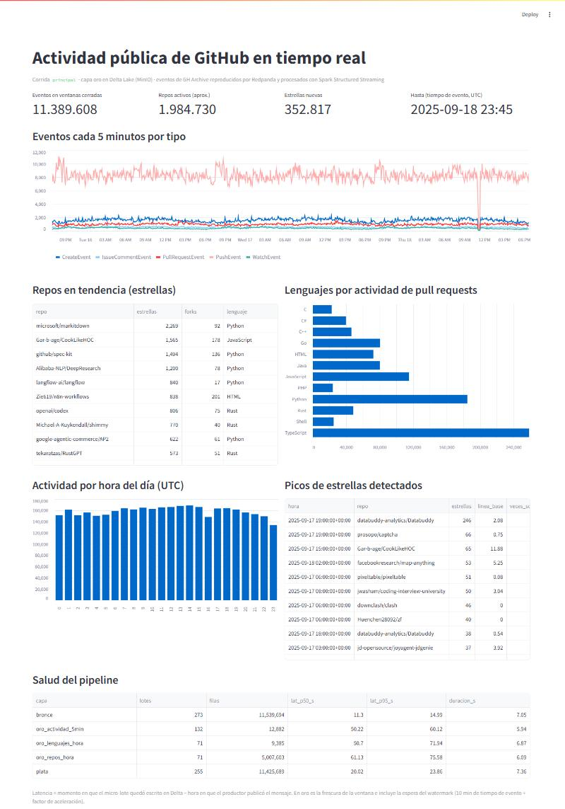
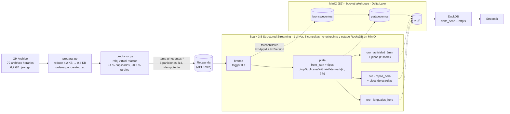
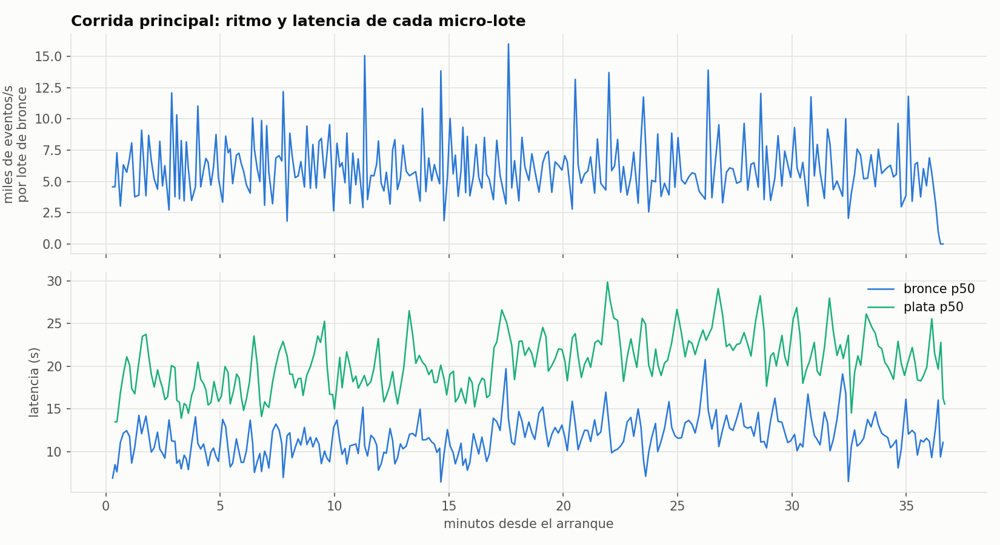
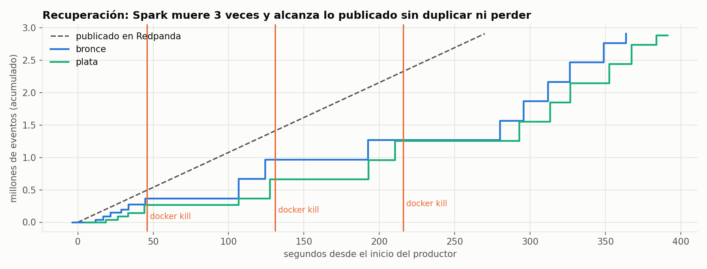
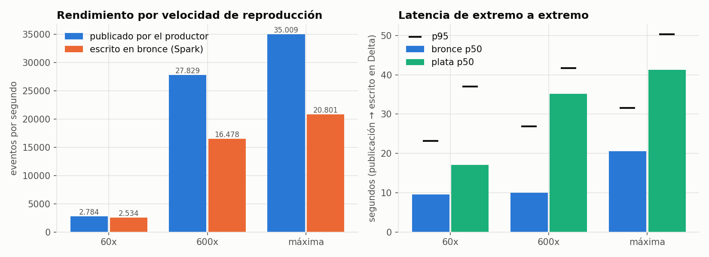
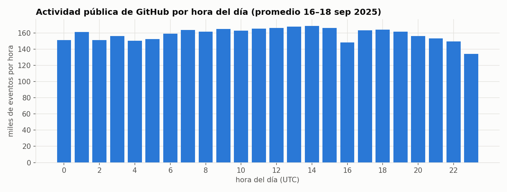
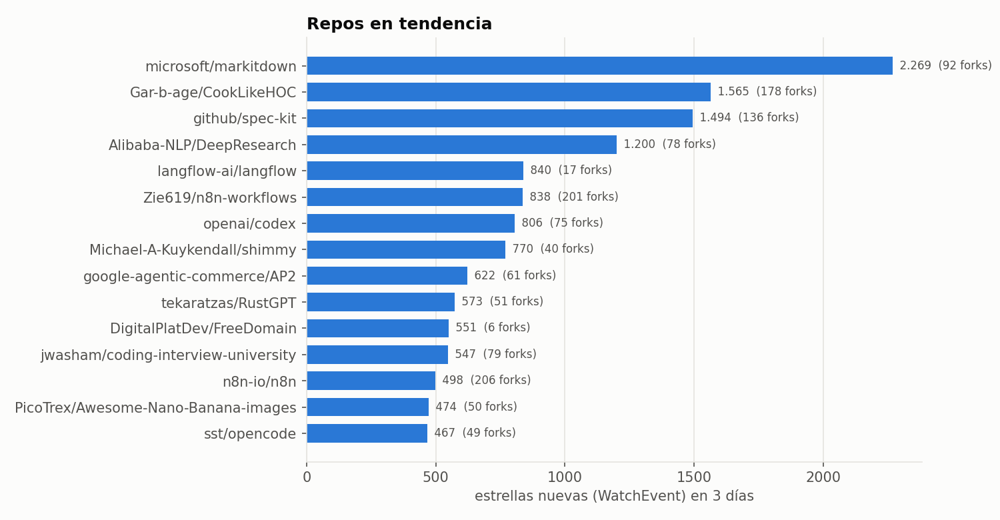
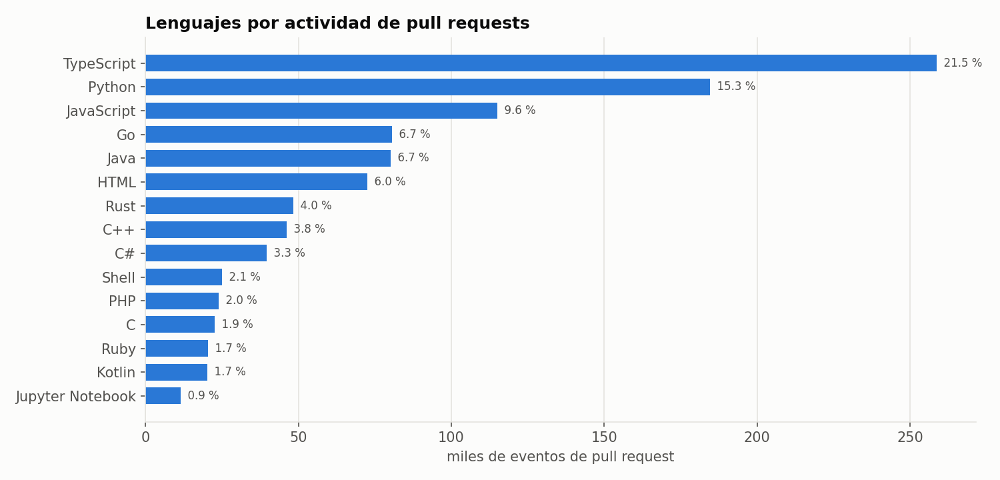
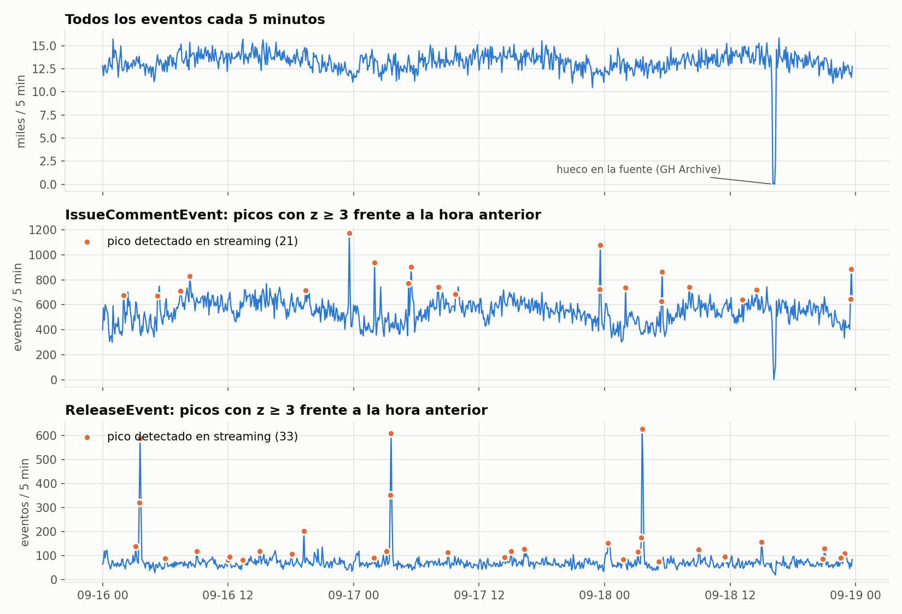

# Streaming en tiempo real de la actividad de GitHub · Redpanda + Spark Structured Streaming + Delta Lake

[](https://github.com/GUAR-NIX/portafolio-cloud/actions/workflows/streaming-github-redpanda-spark.yml)

Plataforma de streaming 100 % local en Docker: **11,4 millones de eventos públicos de GitHub** (GH Archive,
16–18 sep 2025) se reproducen hacia **Redpanda** (Kafka) respetando sus marcas de tiempo, y **Spark Structured
Streaming** los lleva por capas a tablas **Delta Lake en MinIO** (S3 local): **bronce** (mensaje crudo) →
**plata** (tipado y deduplicado) → **oro** (agregados por ventana de tiempo de evento, repos en tendencia,
lenguajes y detección de picos). El pipeline es **exactamente-una-vez**: se le hizo `docker kill` a mitad de la
carga y los conteos cuadran al evento.

| | |
|---|---|
| **Datos** | GH Archive, 72 horas, 6,2 GB comprimidos, 11.425.689 eventos (15 tipos) |
| **Corrida principal** | 3 días de GitHub reproducidos a **120x** en 36 min · 5.285 eventos/s sostenidos |
| **Latencia (p50 / p95)** | bronce 11,6 / 20,5 s · plata 20,4 / 32,2 s, de la publicación en Redpanda a la escritura en Delta |
| **Exactamente una vez** | 3 `docker kill` + 1 falla inyectada tras escribir un lote: **0 duplicados y 0 perdidos** en todas las capas |
| **Rendimiento máximo** | 20.801 eventos/s escritos en bronce con el productor a máxima velocidad |
| **Oro** | 5,03 millones de filas en 5 tablas · 99 picos de estrellas y 241 picos de actividad detectados en streaming |
| **Consultas** | DuckDB directo sobre Delta en MinIO (7 consultas SQL) + tablero Streamlit |
| **Pruebas** | 27 pruebas (Spark local, muestra real de GH Archive) + CI en GitHub Actions |
| **Nube** | Terraform de referencia para MSK Serverless + EMR Serverless + S3 + Glue, **validado y no aplicado**; [costo estimado](#costo-estimado-en-la-nube-aws-sin-desplegar): ≈ 60–900 USD/mes según el escenario |



## Arquitectura



| Capa | Tabla | Grano | Qué demuestra |
|---|---|---|---|
| bronce | `eventos` | un mensaje de Kafka (texto JSON + tema, partición, offset, timestamp, cabeceras) | ingesta cruda, reproducible desde los offsets |
| plata | `eventos` | un evento de GitHub, tipado (20 columnas), partición por fecha | esquema explícito, validación, **deduplicación por id con estado acotado** |
| oro | `actividad_5min` | ventana de 5 min × tipo de evento | ventanas por tiempo de evento, **watermark de 10 min** |
| oro | `repos_hora` | ventana de 1 h × repositorio | estrellas, forks, pushes, commits, PR abiertos/fusionados |
| oro | `lenguajes_hora` | ventana de 1 h × lenguaje | lenguaje del repo base de cada pull request |
| oro | `picos_actividad` | ventana con z ≥ 3 frente a la hora anterior | analítica con historia dentro de `foreachBatch` |
| oro | `picos_repos` | repo con ≥ 15 estrellas en 1 h y ≥ 5× su media de 24 h | detección de repos que se disparan |

## Resultados (ejecución real)

Todas las cifras salen de `reports/metricas/<corrida>/` (cada micro-lote y cada `StreamingQueryProgress` de Spark,
en JSON por línea), resumidas por `streaming_gh.analizar` en [`reports/resultados.json`](reports/resultados.json).
Equipo: Ryzen 5 4600G, Spark en un contenedor con `local[4]` y 4 GB; 5 consultas en el mismo driver.

### Corrida principal: 3 días de GitHub en 36 minutos

| | |
|---|---|
| Ventana de datos | 16-sep-2025 00:00 → 19-sep-2025 00:00 UTC, reproducida a **120x** (1 h de GitHub = 30 s) |
| Publicado en Redpanda | 11.539.694 mensajes = 11.425.689 eventos únicos + 114.005 reenvíos inyectados (1 %), 6 particiones |
| Tardíos inyectados | 11.433 de 3–8 min (dentro del watermark de oro) + 11.103 de 20–40 min (fuera) |
| Ritmo | productor 5.342 eventos/s (atraso máximo frente al reloj virtual: 1,1 s) · **bronce 5.285 eventos/s** sostenidos durante 36 min |
| Micro-lotes | 273 de bronce y 255 de plata; duración mediana 7,1 y 7,4 s (trigger de 3 s: los lotes salen uno tras otro) |
| **Latencia de extremo a extremo** | **bronce p50 11,6 s · p95 20,5 s** · plata p50 20,4 s · p95 32,2 s (máx. 26,1 y 37,1 s) |
| Frescura de oro | p50 51–61 s · p95 75–87 s según la tabla (incluye esperar al watermark, ver *Problemas reales*) |
| Almacenamiento (MinIO) | bronce 976 MiB (1.701 Parquet) · plata 669 MiB · oro 176 MiB · checkpoints y estado 1,0 GiB |



La latencia de bronce se mantiene entre 7 y 20 s durante toda la corrida: el sistema sigue el ritmo sin acumular
retraso. Plata va ~9 s detrás porque lee bronce como streaming (un trigger más).

### Exactamente una vez, con conteos

`streaming_gh.verificar` compara cada capa con la anterior y con oro recalculado en lote desde plata:

| Corrida | Kafka | Bronce (dup.) | Plata = ids únicos del productor | Dup. en plata | Perdidos | Oro vs. recálculo en lote |
|---|---:|---:|---:|---:|---:|---|
| principal (3 días, 120x) | 11.539.694 | 11.539.694 (0) | 11.425.689 | 0 | 0 | idéntico salvo 475 tardíos descartados por el watermark |
| recuperación (18 h, 240x, **3 `docker kill`**) | 2.911.774 | 2.911.774 (0) | 2.882.926 | 0 | 0 | idéntico salvo 3 tardíos descartados |
| falla inyectada (3 h, 120x) | 485.125 | 485.125 (0) | 480.329 | 0 | 0 | idéntico salvo 24 tardíos descartados |
| benchmarks 60x · 600x · máx. | 1.002.041 c/u | 1.002.041 (0) | 992.129 | 0 | 0 | idéntico salvo 366 · 59 · 0 tardíos descartados |

Los 114.005 reenvíos de la corrida principal llegaron a bronce (bronce guarda lo que hay en el tema) y ninguno pasó
a plata. Ninguna ventana de oro tiene más eventos que su recálculo en lote; las que tienen menos son exactamente
las que recibieron un tardío fuera del watermark (212 en `actividad_5min`, 353 en `repos_hora`, que cuadran con el
`numRowsDroppedByWatermark` que reporta Spark).

### Recuperación tras `docker kill`



Se publicaron 18 h de eventos a 240x (≈ 10.800 eventos/s durante 270 s) y se mató el contenedor de Spark con
`docker kill` (SIGKILL, sin apagado limpio) a los 45, 130 y 215 s; el orquestador lo volvió a levantar 20 s después
de cada caída.

| Caída | Driver nuevo listo (5 consultas) | Primera escritura en bronce tras la caída | Lote reanudado |
|---|---:|---:|---|
| t = 45 s | 27,1 s | 60,8 s | 299.997 filas (tope `maxOffsetsPerTrigger`) |
| t = 130 s | 26,9 s | 61,8 s | 299.997 filas |
| t = 215 s | 27,1 s | 64,3 s | 299.997 filas |

Tras la última caída bronce alcanzó lo publicado a los ~364 s y plata a los ~384 s, sin duplicados ni pérdidas. En
dos de las caídas el proceso murió **después de escribir un lote en Delta y antes de confirmarlo en el checkpoint**
(bronce lote 10, oro `repos_hora` lote 4): al reanudar, Spark repitió esos lotes y Delta ignoró la escritura
(`escritura_omitida_por_txn` en `lotes.jsonl`). Para mostrarlo de forma determinista, la corrida
`falla_inyectada` mata el proceso justo después de escribir el lote 8 de plata (`FALLA_TRAS_ESCRIBIR=plata:8`): al
reanudar, plata repitió el lote 8 (23.279 filas) y bronce el 10 (32.179), y Delta no escribió ninguno de los dos.

En un ensayo con caídas cada 50 s, la segunda y la tercera cayeron *durante* el rearranque (el driver
tarda ~27 s en levantar y el primer lote de puesta al día ~15 s más) y bronce no escribió nada durante 2,5 minutos;
aun así los conteos cuadraron. Por eso las caídas quedaron espaciadas en la corrida final.

### Rendimiento a tres velocidades

Las mismas 6 horas de GitHub (17-sep, 12:00–18:00 UTC, 1.002.041 mensajes) con el productor a 60x, a 600x y sin
esperas.



| Velocidad | Publicado | Escrito en bronce | Plata | Latencia bronce p50 / p95 | Latencia plata p50 / p95 |
|---|---:|---:|---:|---:|---:|
| 60x | 2.784 ev/s durante 6 min | 2.534 ev/s* | 2.537 ev/s* | 9,5 / 23,2 s | 17,1 / 37,0 s |
| 600x | 27.829 ev/s durante 36 s | 16.478 ev/s | 14.500 ev/s | 10,0 / 26,9 s | 35,2 / 41,7 s |
| máxima | 35.009 ev/s durante 29 s | **20.801 ev/s** | 17.368 ev/s | 20,5 / 31,5 s | 41,2 / 50,3 s |

\* A 60x Spark va al ritmo del productor (la tasa media incluye el último lote); el techo aparece a 600x.

- **El techo local está en ~16.000–21.000 eventos/s en bronce** con las 5 consultas compartiendo 4 núcleos. Por
  encima, Redpanda absorbe la diferencia y Spark la consume en lotes de hasta 300.000 mensajes; el lote más
  rápido escribió 43.306 ev/s.
- La latencia p50 casi no cambia entre 60x y 600x porque el costo fijo por lote (commit de Delta en MinIO,
  checkpoint) domina; sube a máxima velocidad porque los lotes crecen (mediana 12 s).
- La corrida principal (120x, 5.342 ev/s) queda a un tercio del techo: hay margen para picos.

### Lo que dicen los datos (oro, consultado con DuckDB)



- **11.389.608 eventos** en ventanas cerradas: 62,3 % `PushEvent`, 12,0 % `CreateEvent`, 7,4 %
  `PullRequestEvent`, 3,1 % estrellas (`WatchEvent`). La hora de más actividad es las **14:00 UTC** (168.577
  eventos por hora en promedio, 9:00 en Ecuador) y la de menos las 23:00 UTC (133.936): GitHub nunca duerme, pero
  sigue la jornada de Europa y América.
- **Repos en tendencia:** `microsoft/markitdown` sumó 2.269 estrellas en 3 días, seguido de
  `Gar-b-age/CookLikeHOC` (1.565, que pasó del 3.er al 1.er puesto del día el 18-sep), `github/spec-kit` (1.494) y
  `Alibaba-NLP/DeepResearch` (1.200).
- **Lenguajes** (por eventos de pull request): TypeScript 21,5 %, Python 15,3 %, JavaScript 9,6 %, Go 6,7 %,
  Java 6,7 %.
- **Picos detectados en streaming:** 99 repos que se dispararon frente a su media de 24 h (el mayor,
  `databuddy-analytics/Databuddy`: 246 estrellas en una hora frente a 2,1 por hora, 118x) y 241 ventanas de 5 min
  con z ≥ 3, sobre todo `ReleaseEvent` (ráfagas de publicaciones automáticas de hasta 629 en 5 min, z = 15,8).
- **Hueco en la fuente:** el 18-sep entre 16:05 y 16:20 UTC GH Archive solo tiene 147 eventos (frente a ~13.000
  cada 5 min). Es un corte del lado de GitHub/GH Archive, no del pipeline: las horas completas tienen sus ~160.000
  eventos y el pipeline los procesó todos.





Consultas en [`sql/`](sql) y resultados en [`reports/consultas/`](reports/consultas).

### Problemas reales que aparecieron al correrlo

1. **Un tardío "fuera del watermark" no se descartaba.** La prueba esperaba que un evento 59 min más viejo que el
   máximo se descartara y no pasaba. Desde Spark 3.4, cada micro-lote filtra tardíos con el watermark del **lote
   anterior** y desaloja estado con el actual. La prueba ahora fija ese comportamiento con lotes controlados, y
   explica por qué en la corrida principal solo 475 de los 11.056 tardíos de 20–40 min se descartaron: a 120x un
   lote de oro (10 s + procesamiento) cubre 20–30 min de tiempo de evento, así que la tolerancia efectiva fue de
   ~40–60 min. Los benchmarks lo confirman: con los mismos datos se descartaron 366 tardíos a 60x, 59 a 600x y 0 a máxima velocidad (cuanto más rápido corre el reloj, más tiempo de evento cubre cada lote). En tiempo real (factor 1) la tolerancia sería de ~10 min y unos segundos. Por lo mismo, la frescura de oro
   (~1 min) es sobre todo espera: plata (20 s) + trigger de oro (10 s) + un lote más hasta que el watermark pasa
   el fin de la ventana.
2. **Sin evidencia de la escritura idempotente.** Las primeras caídas nunca cayeron entre la escritura en Delta y
   el commit del checkpoint, y además el registro de la omisión se sobrescribía con las latencias. Se corrigió el
   registro, se añadió la detección (versión de Delta antes/después vía `DeltaLog.update(False, Option.empty())`,
   porque Py4J no ve los parámetros por defecto de Scala) y la **inyección de fallos** determinista.
3. **El productor murió por memoria a los 31 min** (código 137): guardaba los 10 M de ids vistos en un `set` de
   Python (~900 MB en un contenedor de 768 MB). Ahora usa un `array('q')` de 8 bytes por id (~90 MB).
4. **Spark rozaba el límite de memoria** (3,9 GB de RSS con 2 GB de heap): RocksDB, buffers directos y arenas de
   malloc viven fuera del heap. Se acotaron (`boundedMemoryUsage` de RocksDB a 512 MB,
   `-XX:MaxDirectMemorySize=512m`, `MALLOC_ARENA_MAX=2`) y la corrida principal se repitió desde cero con un
   contenedor de 4 GB; se estabilizó en ~3,6 GB sin ningún OOM.
5. **El tablero se caía** (`duckdb::OutOfMemoryException`): dos sesiones agregaban a la vez los 5 M de filas de
   `repos_hora`. DuckDB ahora tiene `memory_limit` con desborde a disco, un cursor por consulta (la conexión no es
   segura entre hilos) y el ranking filtra primero las horas con estrellas.
6. **MinIO ya no publica imágenes** (`minio/minio` no existe en Docker Hub ni en quay.io desde fines de 2025): se
   compila desde el código fuente oficial en `docker/minio/Dockerfile`.

## Decisiones técnicas

| Decisión | Por qué | Alternativa descartada |
|---|---|---|
| **Delta Lake** | `txnAppId`/`txnVersion` dan escrituras idempotentes desde `foreachBatch`; paquete pip alineado con Spark 3.5 | Iceberg: necesita un catálogo (REST/Hive/Glue) para lo mismo |
| **Redpanda** | API de Kafka sin ZooKeeper ni JVM, arranca en segundos con 1 GB | Kafka + ZooKeeper/KRaft: más memoria |
| **Un driver con 5 consultas** | comparte la JVM y la memoria; cada capa tiene su checkpoint y puede reiniciarse sola | un `spark-submit` por capa: 3 JVM en 8 GB |
| **Bronce → plata → oro encadenados por Delta** | cada capa se puede reprocesar desde la anterior; bronce es la fuente de verdad reproducible | parsear y agregar en una sola consulta desde Kafka |
| **Watermark de 2 h en plata y 10 min en oro** | plata solo olvida ids viejos (un tardío de 30 min sigue entrando al dato tipado); oro necesita cerrar ventanas pronto | un único watermark: o se pierden tardíos en plata o oro tarda 2 h en cerrar |
| **`dropDuplicatesWithinWatermark`** | estado acotado (cada id vive 2 h); no exige que el duplicado traiga el mismo timestamp | `dropDuplicates`: estado infinito |
| **RocksDB como almacén de estado** | estado fuera del heap con *changelog checkpointing*; los cientos de miles de claves abiertas de `repos_hora` y de ids de plata no presionan al GC | HDFSBackedStateStore: todo el estado en el heap |
| **Reducir eventos en el productor** | 4,2 KB → 0,4 KB por evento; el 90 % del payload no se usa | mandar el JSON completo: ~48 GB por el tema en 3 días |
| **Checkpoints en MinIO** | igual que en la nube (S3); sobreviven a que el contenedor desaparezca | volumen local: más rápido pero no se parece a producción |
| **Latencia medida con el timestamp de Kafka** | `CreateTime` = hora de publicación; el driver mide al terminar de escribir en Delta | marca de tiempo propia en el mensaje: ensucia el evento |
| **Picos dentro de `foreachBatch`** con historia leída de oro | las funciones de ventana no existen en streaming; el estado queda en Delta y sobrevive a caídas | `mapGroupsWithState`: más código y estado opaco |
| **DuckDB para consultar oro** | lee Delta en S3 sin clúster; el tablero no compite con Spark | Trino: un servicio más con 1–2 GB |

**Limitaciones.** Es un solo nodo: las cifras de rendimiento valen para 4 núcleos y no dicen nada de un clúster.
El reloj acelerado comprime el tiempo de evento, así que la frescura de oro y la tolerancia a tardíos no se
traducen 1:1 a tiempo real (ver el punto 1 de arriba). Las últimas ventanas de cada corrida nunca se cierran porque
no llegan eventos posteriores que hagan avanzar el watermark. El lenguaje solo se conoce para repos con actividad
de pull requests en el periodo. Bronce y plata no se compactan (`OPTIMIZE`): quedan miles de Parquet chicos.

## Estructura

```
src/streaming_gh/          config · reducir · preparar · productor · spark_comun · transformaciones (lógica pura)
                           pipeline (5 consultas, foreachBatch idempotente, métricas) · verificar · consultas_oro · analizar
scripts/                   descargar_datos.py · crear_muestra.py · orquestar.py (corridas reanudables)
sql/                       7 consultas de negocio sobre oro (DuckDB)
dashboard/app.py           Streamlit + DuckDB
tests/                     27 pruebas: reducción, productor, capas en lote, watermark y dedup en streaming, pipeline, muestra
docker/                    spark/Dockerfile (Python 3.11 + Java 17 + PySpark 3.5.3 + conectores) · minio/Dockerfile
docker-compose.yml         redpanda · redpanda-console · minio · minio-init · spark · productor · tareas · pruebas · dashboard
infra/terraform/aws/       MSK Serverless + EMR Serverless + S3 + Glue (referencia, no aplicado)
reports/                   resultados.json · metricas/<corrida>/ · figures/ · consultas/ · capturas/ · terraform_validate.txt
data/muestra/              1.514 eventos crudos reales (correos anonimizados) para pruebas y CI
docs/GUIA_PASO_A_PASO.md   cómo correrlo, recuperación, nube y preguntas de entrevista
```

## Cómo reproducirlo

Paso a paso en [docs/GUIA_PASO_A_PASO.md](docs/GUIA_PASO_A_PASO.md).

```powershell
python scripts\descargar_datos.py                                          # 6,2 GB, reanudable
docker compose build
docker compose run --rm productor python -m streaming_gh.preparar          # ~5 min
docker compose run --rm pruebas                                            # 27 pruebas
python scripts\orquestar.py corrida --nombre principal --factor 120        # ~45 min
python scripts\orquestar.py recuperacion --repetir                         # ~10 min, 3 docker kill
python scripts\orquestar.py falla                                          # ~5 min
python scripts\orquestar.py benchmark --factores 60,600,0                  # ~15 min
docker compose run --rm tareas python -m streaming_gh.consultas_oro --corrida principal
docker compose run --rm tareas python -m streaming_gh.analizar
docker compose up -d dashboard                                             # http://localhost:8501
docker compose down
```


## Costo estimado en la nube (AWS, sin desplegar)

Estimación de orden de magnitud para llevar este diseño a AWS (`infra/terraform/aws/`: MSK Serverless + EMR
Serverless + S3 + Glue). **No se desplegó nada**: son cálculos con tarifas de lista de `us-east-1` que conviene
confirmar en la [calculadora de AWS](https://calculator.aws/) antes de decidir.

**Supuestos de carga** (salen de las corridas medidas): 11,4 M de eventos en 3 días ≈ 3,8 M/día ≈ 44 eventos/s en
tiempo real; ~0,4 KB por evento tras reducir ≈ 1,5 GB/día ≈ 46 GB/mes de entrada al tema; 6 particiones; un solo
consumidor (Spark). Almacenamiento S3: 2,8 GiB cada 3 días (bronce + plata + oro + checkpoints) ≈ 28 GiB/mes. EMR
Serverless con 6 vCPU y 24 GB en total (1 driver de 2 vCPU/8 GB + 1 ejecutor de 4 vCPU/16 GB).

**Tarifas usadas (aprox.):** MSK Serverless 0,75 USD por clúster-hora + 0,0015 USD por partición-hora + 0,10 USD/GB
de entrada y 0,05 USD/GB de salida · Kinesis Data Streams con 1 *shard* aprovisionado 0,015 USD/hora + 0,014 USD por
millón de unidades PUT · EMR Serverless 0,0526 USD por vCPU-hora y 0,00578 USD por GB-hora · S3 0,023 USD/GB-mes ·
Athena 5 USD/TB escaneado · Glue Data Catalog gratis bajo 1 M de objetos.

| Escenario | Streaming | Cómputo (EMR Serverless) | S3 + Glue + Athena + logs | Total aprox. |
|---|---:|---:|---:|---:|
| **A. Demo reproducible**: una corrida de 3 días a 120x (~1 h) | MSK ≈ 1,5 USD (1 h de clúster + 4,6 GB) | ≈ 0,5 USD (1 h × 0,45 USD/h) | < 0,5 USD | **≈ 2,5 USD por corrida** |
| **B. Producción 24/7** con MSK Serverless | MSK ≈ 561 USD/mes (730 h × 0,75 + particiones + tráfico) | ≈ 332 USD/mes (730 h × 0,45 USD/h) | ≈ 3 USD/mes | **≈ 900 USD/mes** |
| **C. Producción 24/7** con Kinesis (1 *shard*) | Kinesis ≈ 13 USD/mes | ≈ 332 USD/mes | ≈ 3 USD/mes | **≈ 350 USD/mes** |
| **D. Micro-lotes cada hora** (`trigger(availableNow=True)`, ~8 min por ejecución) con Kinesis | ≈ 13 USD/mes | ≈ 44 USD/mes (96 h × 0,45 USD/h) | ≈ 3 USD/mes | **≈ 60 USD/mes** |

Lecturas para decidir:

- **Con 44 eventos/s el costo lo domina el cómputo y el clúster fijo, no el volumen.** MSK Serverless cobra ~550 USD
  al mes solo por tener el clúster encendido; con esta carga cabe en 1 *shard* de Kinesis (1.000 registros/s), 40
  veces más barato.
- **Cambiar a Kinesis no es solo un cambio de Terraform:** el código lee de Kafka (`readStream.format("kafka")`) y
  habría que usar el conector de Kinesis para Spark; por eso el Terraform de referencia deja MSK.
- **Si la latencia de minutos basta, D es la opción razonable** (≈ 6 veces menos que C): se pierde la baja latencia
  de 12–30 s que se midió, pero se conservan la idempotencia y la deduplicación.
- **No incluye** transferencia entre zonas ni hacia Internet, NAT gateway (≈ 33 USD/mes por gateway si las subredes
  privadas lo necesitan), KMS, ni el tablero (Streamlit en App Runner ≈ 5–25 USD/mes).

## Fuente de datos y licencia

| Fuente | Qué se usa | Licencia |
|---|---|---|
| [GH Archive](https://www.gharchive.org/) (`https://data.gharchive.org/AAAA-MM-DD-H.json.gz`) | eventos públicos de GitHub del 16 al 18 de septiembre de 2025, 72 archivos horarios | El proyecto GH Archive es de código abierto ([MIT](https://github.com/igrigorik/gharchive.org/blob/master/LICENSE)); los eventos son datos públicos de la [API de GitHub](https://docs.github.com/en/rest/activity/events), sujetos a sus [términos](https://docs.github.com/en/site-policy/github-terms/github-terms-of-service) |

Se eligió septiembre de 2025 porque desde el 7-oct-2025 GitHub recorta los payloads de la API de eventos (sin
commits ni el objeto `pull_request`), y con eso se pierde el lenguaje del repositorio.


**Licencia.** El **código** de este repositorio es MIT ([LICENSE](LICENSE)). Los **datos** no lo son: siguen la
licencia y los términos de su fuente, los de la tabla de arriba. La muestra de pruebas `data/muestra/` contiene
eventos públicos reales de GH Archive cuyos correos de commit se reemplazaron por un hash (`u…@ejemplo.invalid`,
ver `scripts/crear_muestra.py`); los nombres de usuario de GitHub, que son públicos, se conservan.

## Parte de un portafolio

Proyecto 21 de 30. Los proyectos originales (SQL, Python, ML, IA y Cloud) usan las importaciones de la
SENAE; este cambia a datos de eventos para mostrar procesamiento en tiempo real con garantías de entrega.
